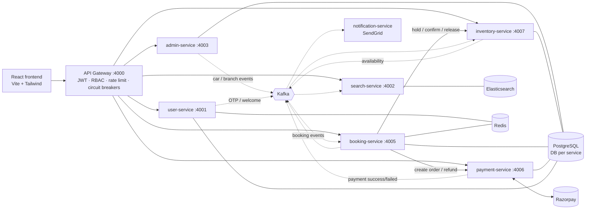

# 🚗 SR-CarRentals — Event-Driven Car Rentals & Shared Rides

A car platform built as Node.js microservices with two ways to travel:

- **Rent a car** — book a whole car, self-drive, for a time window.
- **Book a seat** — buy individual seats on scheduled shared rides between cities, paying only for your stretch of the route (e.g. Hyderabad → Suryapet on a Hyderabad → Vijayawada trip).

Customers see only what is actually free, pay with Razorpay and get email confirmations. Admins manage branches, the fleet, routes and trip schedules — and one fleet serves both modes without double-booking a car.

**Author**: SaiRaghava · sairaghava1318@gmail.com

---

## Highlights

| Problem | How it's solved |
|---|---|
| **Seat sold twice on overlapping stretches of a shared ride** | Seat holds cover stop ranges `[fromSeq, toSeq)` — seat 1 can be sold Hyderabad→Suryapet *and* Suryapet→Vijayawada, but never across both. Per-trip row lock + overlap check, Redis per-seat locks, and a second **exclusion constraint** on `(tripId, seatNumber, int4range(fromSeq, toSeq))` |
| **One car, two products** | Scheduling a trip synchronously reserves the car for the trip window in inventory (409 if it's rented); rentals see trips as blocked time — the same exclusion constraint protects both |
| **Two people booking the same car for overlapping dates** | Three layers: a Redis lock per car + window (fast reject), a `SELECT … FOR UPDATE NOWAIT` row lock with an interval-overlap check in inventory-service, and a **Postgres `EXCLUDE USING gist` constraint** on `(carId, tsrange(startAt, endAt))` that makes overlapping reservations impossible at the database level |
| **Distributed transaction across inventory + payment** | Orchestrated **saga** (`HOLD_CAR → CREATE_PAYMENT → CONFIRM_CAR`) with a persisted saga log and reverse-order compensation |
| **Concurrent state changes** (payment webhook vs. expiry job vs. user cancel) | Optimistic locking (compare-and-swap on a `version` column) — exactly one actor wins each transition |
| **Customer pays after the hold expired** | Late payments are detected and **automatically refunded** |
| **Duplicate requests / redelivered events** | Client idempotency keys on booking creation; idempotent, upsert-based Kafka consumers; per-service **dead-letter queues** |
| **Search must reflect live availability** | Inventory publishes each car's booked intervals; Elasticsearch stores them as a `date_range` field and filters with `relation: intersects`. Ride search matches trips whose stops pass through *from* before *to* (nested queries) and fetches live seats-left per stretch in one batch call, degrading gracefully if inventory is slow |
| **Search index lost / rebuilt** | On index recreation, search-service seeks its partitions to offset 0 and **rebuilds the index from Kafka history** |
| **Fuzzy locations** | Exact branch code → city → completion suggester → fuzzy match, plus aliases (`Bangalore → Bengaluru`, `Bombay → Mumbai`) |
| **Authorization** | JWT access/refresh tokens (httpOnly cookies, refresh rotation with reuse detection); `role` claim + gateway-enforced **ADMIN-only** fleet APIs; gateway strips client-supplied identity headers |
| **Cold-start races** | All Kafka topics are created up-front before consumers subscribe |

### Frontend

React 18 + Vite + Tailwind + Zustand. Light/dark/system theme (no flash on load), real car photos with graceful fallbacks, availability-aware search with facet counts and "best price" badges, remembered last search and shareable search URLs, quick trip-length picks, live payment-hold countdown with **resume payment**, upcoming/past trips, mobile navigation, skeleton loading states, and motion that respects `prefers-reduced-motion`.

---

## Architecture

> Design patterns (all 23 GoF, where and why each is or isn't used), class diagrams and the distributed-systems patterns are explained in **[docs/DESIGN_PATTERNS.md](docs/DESIGN_PATTERNS.md)**.



### Booking flow (rentals — seat bookings follow the same saga with `HOLD_SEATS` / `CONFIRM_SEATS`)

1. **Search** — `GET /search/cars?location=Hyderabad&pickupAt=…&dropoffAt=…` returns only `ACTIVE` cars with no booked interval intersecting the window, plus facet counts and a price estimate.
2. **Quote** — `GET /bookings/bookings/quote` returns the authoritative price.
3. **Book** — booking-service validates the window and driver, takes a Redis lock, then runs the saga: inventory places a 10-minute **hold** (`rental_holds`, status `LOCKED`), payment-service creates a Razorpay order.
4. **Pay** — Razorpay checkout → `verify-payment` (or the signed webhook) → `payment.success` on Kafka → booking-service confirms the hold (`BOOKED`) → `booking.confirmed` → confirmation email.
5. **Expire / cancel** — unpaid holds are released by expiry jobs (leader-elected via Redis / Postgres advisory locks); cancellations refund according to policy.

---

## Business rules

| Rule | Value |
|---|---|
| Billing | Every started 24 h block is one rental day, after a 30-minute grace period |
| Long-rental discount | 10 % off for 7+ days |
| Cancellation | Full refund ≥ 24 h before pickup · 50 % within 24 h · not cancellable after pickup |
| Booking window | Pickup ≥ 1 h from now, ≤ 180 days ahead · max 30 days per rental |
| Driver age | 18–80 (25+ for `LUXURY`) |
| Payment window | Car is held for 10 minutes while the customer pays |
| Fleet changes | Moving a car to `MAINTENANCE`/`RETIRED` cancels its upcoming bookings and trips with a full refund |
| Shared-ride fare | Distance travelled × the trip's ₹/km, per seat (minimum ₹100); up to 6 seats per booking |
| Shared-ride sales | Close 30 minutes before the boarding stop; cancelling a trip cancels and fully refunds every seat on it |

---

## Services & ports

| Service | Port | Responsibility | Storage |
|---|---|---|---|
| api-gateway | 4000 | Routing, JWT auth, ADMIN role check, rate limiting, circuit breakers | Redis |
| user-service | 4001 | Sign-up with email OTP, login, Google sign-in, refresh-token rotation, profile | Postgres, Redis |
| search-service | 4002 | Car search with availability filtering, facets, location autocomplete, shared-ride search | Elasticsearch |
| admin-service | 4003 | Branches, fleet (cars, rates, status), routes and trip schedules | Postgres |
| notification-service | — | Kafka consumer → SendGrid emails | — |
| booking-service | 4005 | Quotes, booking saga, cancellation/refund policy, expiry job | Postgres, Redis |
| payment-service | 4006 | Razorpay orders, signature verification, webhooks, refunds, audit log | Postgres |
| inventory-service | 4007 | Car holds/reservations, trip seat maps and seat holds, overlap checks, lock expiry | Postgres |
| frontend | 3000 | React SPA | — |

### Kafka topics

| Topic | Producer → Consumers |
|---|---|
| `admin.branch-created` | admin → search |
| `admin.car-created`, `admin.car-updated` | admin → inventory, search |
| `admin.car-status-changed` | admin → inventory, search, booking |
| `admin.trip-scheduled`, `admin.trip-cancelled` | admin → inventory, search (+ booking for cancellations) |
| `inventory.car-availability-updated` | inventory → search |
| `payment.success`, `payment.failed` | payment → booking |
| `booking.confirmed`, `booking.cancelled`, `booking.failed` | booking → notification |
| `notification.otp-email`, `notification.welcome-email` | user → notification |
| `dlq.*` | per-service dead-letter queues |

---

## Getting started

### Prerequisites

- Node.js 18+ (22 recommended)
- Docker Desktop
- Free accounts for [SendGrid](https://app.sendgrid.com/settings/api_keys) (with a [verified sender](https://app.sendgrid.com/settings/sender_auth)), [Razorpay test keys](https://dashboard.razorpay.com/app/website-app-settings/api-keys) and a [Google OAuth client ID](https://console.cloud.google.com/apis/credentials)

### 1. Infrastructure

Set the infrastructure passwords first (the file is gitignored):

```bash
cp .env.example .env      # then replace the change_me_* values with strong passwords
docker compose up -d postgres redis zookeeper kafka elasticsearch
```

Create one database per service:

```bash
for db in user admin booking inventory payment; do
  docker exec postgres psql -U admin -d postgres -c "CREATE DATABASE ${db}_service_database"
done
```

### 2. Configure and install

For each service folder (and `frontend/`):

```bash
cp .env.example .env      # then fill in secrets
npm ci
```

- `JWT_ACCESS_SECRET` / `JWT_REFRESH_SECRET` must be identical in `user-service` and `api-gateway`.
- `OTP_HMAC_SECRET` is required in `user-service/.env` (there is no built-in default).
- `INTERNAL_SERVICE_KEY` must be identical in `api-gateway` **and** every service that has it. The gateway sends it with each request so services can trust the `x-user-id` header; a request that bypasses the gateway is rejected.
- Use the Postgres and Redis passwords from the root `.env` in each service's `DATABASE_URL` / `REDIS_URL`.
- Add your email to `ADMIN_EMAILS` in `user-service/.env` to get fleet-admin access.
- **Email sender:** `MAIL_SEND` must be a SendGrid-verified sender on a domain whose DMARC policy doesn't reject third-party senders (a Gmail address works; many college/company domains use `p=reject`, which silently drops every email). Check with `nslookup -type=txt _dmarc.<domain>`.
- For local development you can set `LOG_OTP_IN_DEV=true` in `user-service/.env` to also print sign-up OTPs to the user-service log (ignored when `NODE_ENV=production`).

### 3. Database schemas

```bash
for s in user-service admin-service booking-service inventory-service payment-service; do
  (cd $s && npx prisma db push && npx prisma generate)
done
```

The overlap-preventing exclusion constraint is applied automatically by inventory-service on startup.

### 4. Run

Make sure the containers from step 1 are up (`docker compose ps`), then start the services.
**Option A: one terminal per service** (best while studying, because you see each log):

```bash
cd user-service && npm run dev
cd admin-service && npm run dev
cd inventory-service && npm run dev
cd payment-service && npm run dev
cd booking-service && npm run dev
cd search-service && npm run dev
cd notification-service && npm run dev
cd api-gateway && npm run dev
cd frontend && npm run dev        # http://localhost:3000
```

**Option B: all backend services from one terminal** (Git Bash / macOS / Linux; logs go to `logs/`):

```bash
mkdir -p logs
for s in user-service admin-service inventory-service payment-service booking-service search-service notification-service api-gateway; do
  (cd $s && nohup node src/index.js > ../logs/$s.log 2>&1 &)
done
cd frontend && npm run dev
```

> Start each service **once**. A second copy of a service still joins its Kafka consumer group even if
> its HTTP port is taken, and silently takes half of the events (see Troubleshooting).

### 5. Check that everything is up

```bash
for p in 4000 4001 4002 4003 4005 4006 4007; do
  printf "%s → %s\n" $p "$(curl -s -o /dev/null -w '%{http_code}' http://localhost:$p/health)"
done
# every line should end in 200 (notification-service, 4004, has no HTTP server: check its log
# for "Email consumer running")

curl "http://localhost:4000/api/search/cars?location=Hyderabad"   # after seeding: "count" > 0
```

On startup search-service rebuilds its Elasticsearch index by replaying Kafka, so car search can be
empty for the first ~10–30 seconds.

### 6. Stop

```bash
# Ctrl+C in each terminal (Option A), or stop the node processes (Option B), then:
docker compose stop          # keeps your data; `docker compose down -v` deletes it
```

### 7. Demo data

Register through the UI with an email listed in `ADMIN_EMAILS`, then:

```bash
ADMIN_EMAIL=you@example.com ADMIN_PASSWORD=yourpassword node scripts/seed-demo.js
```

This creates branches in Hyderabad, Bengaluru, Mumbai, Suryapet and Vijayawada, a mixed fleet, a Hyderabad → Suryapet → Vijayawada route and daily shared-ride trips for the next 5 days. It is safe to re-run.

### Troubleshooting

| Symptom | Cause | Fix |
|---|---|---|
| `docker compose up` says *port is already allocated* (e.g. 8081) | Another container uses that port | Only the admin UIs (pgAdmin 8081, Kafka UI 8080, Kibana 5601) are optional. Start just the core: `docker compose up -d postgres redis zookeeper kafka elasticsearch` |
| Car search returns 0 cars right after a restart | search-service is still replaying Kafka into a fresh index | Wait ~30 s; check its log for `Replaying Kafka history` |
| Car search stays empty, logs say *group is rebalancing* forever | Two copies of a service are running and sharing the consumer group | Stop **all** node processes, then start each service once |
| `429 Too many requests` when creating bookings | Anti-abuse limit: 5 booking attempts per minute per IP | Wait a minute (this is intended) |
| No OTP email arrives | Sender not verified, or the sender's domain rejects third-party mail (DMARC) | See the *Email sender* note in step 2; set `LOG_OTP_IN_DEV=true` to read the OTP from the user-service log |
| A service exits with *Missing required environment variable* | `.env` incomplete | Copy the missing key from that service's `.env.example` |
| `401 User context missing - must come through gateway` | You called a service port directly, or `INTERNAL_SERVICE_KEY` differs between gateway and service | Call through `http://localhost:4000/api/...`; make the keys identical |
| Payment stays *pending* after paying in test mode | Razorpay can't reach `localhost` with webhooks | Payment is confirmed from the browser via `verify-payment`; for webhooks use a tunnel (e.g. `ngrok http 4000`) and set it in the Razorpay dashboard |

---

## Start here: how to study this project

Study it **in the order a request flows**, one module at a time. The full plan, with the files to
read in order, the concepts, the questions to answer and the exercises, is in
**[docs/STUDY_GUIDE.md](docs/STUDY_GUIDE.md)**. The design patterns and class diagrams are in
**[docs/DESIGN_PATTERNS.md](docs/DESIGN_PATTERNS.md)**.

| Order | Module | You learn |
|------:|--------|-----------|
| 0 | Run it, book a car and a seat | How the pieces fit together |
| 1 | `api-gateway/` | Proxy, auth, rate limiting, circuit breaker |
| 2 | `user-service/` | JWT + refresh tokens, OTP, Redis |
| 3 | `admin-service/` | Publishing events to Kafka |
| 4 | `inventory-service/` | Locks, overlap checks, DB constraints |
| 5 | `search-service/` | Elasticsearch, CQRS, event replay |
| 6 | `booking-service/` ⭐ | Saga, State machine, idempotency |
| 7 | `payment-service/` | Razorpay, webhooks, refunds |
| 8 | `notification-service/` | Consumers, dead-letter queue |
| 9 | `shared/` | Code every service reuses |
| 10 | `frontend/` | React client, polling, error handling |

---

## API overview (via gateway, prefix `/api`)

| Method | Path | Auth |
|---|---|---|
| POST | `/users/auth/send-otp`, `/users/auth/verify-otp`, `/users/auth/login`, `/users/auth/google-auth`, `/users/auth/refresh` | public |
| GET/PUT/DELETE | `/users/user/profile` | user |
| GET | `/search/cars?location=&pickupAt=&dropoffAt=&category=&transmission=&fuelType=&minSeats=&maxPrice=&sort=` | public |
| GET | `/search/autocomplete?q=` | public |
| GET | `/inventory/cars/:carId/availability?startAt=&endAt=` | public |
| GET | `/search/rides?from=&to=&date=YYYY-MM-DD&seats=` | public |
| GET | `/inventory/trips/:tripId/seats?fromSeq=&toSeq=` | public |
| GET | `/bookings/bookings/seat-quote?tripId=&fromSeq=&toSeq=&seats=` | user |
| POST | `/bookings/bookings` — `{ type: 'SEAT', tripId, fromSeq, toSeq, seatNumbers, passengers: [{ name, age, gender }], idempotencyKey }` | user |
| GET | `/bookings/bookings/quote?carId=&pickupAt=&dropoffAt=` | user |
| POST | `/bookings/bookings` — `{ carId, pickupAt, dropoffAt, driver: { name, age, licenseNumber, phone }, idempotencyKey }` | user |
| GET | `/bookings/bookings`, `/bookings/bookings/:id` | user |
| POST | `/bookings/bookings/:id/verify-payment`, `/bookings/bookings/:id/cancel` | user |
| POST/GET | `/admins/branches/branch` | **admin** |
| POST/GET | `/admins/cars/car`, GET/PUT `/admins/cars/car/:id`, PATCH `/admins/cars/car/:id/status` | **admin** |
| POST/GET | `/admins/rides/route`, `/admins/rides/trip`, PATCH `/admins/rides/trip/:id/cancel` | **admin** |
| POST | `/payments/webhooks/razorpay` | Razorpay signature |

---

## Project structure

```
├── api-gateway/          # Express gateway: auth, RBAC, proxy, rate limits, circuit breakers
├── user-service/         # Auth, OTP, sessions, profile
├── admin-service/        # Branches + fleet (Prisma)
├── inventory-service/    # Car holds/reservations + exclusion constraint (Prisma)
├── booking-service/      # Saga, pricing & cancellation policy, expiry job (Prisma + Redis)
├── payment-service/      # Razorpay gateway abstraction, webhooks, refunds (Prisma)
├── search-service/       # Elasticsearch indices, availability search, autocomplete
├── notification-service/ # SendGrid email templates
├── shared/               # Kafka topics, DLQ wrapper, topic bootstrap, EventConsumer base class
├── frontend/             # React + Vite + Tailwind + Zustand (car photos + credits in public/cars/)
├── docs/                 # STUDY_GUIDE.md (what to study first) · DESIGN_PATTERNS.md (patterns + class diagrams)
├── scripts/seed-demo.js  # Demo branches & cars
└── docker-compose.yml    # Postgres, Redis, Kafka/Zookeeper, Elasticsearch (+ admin UIs)
```

---

## Credits

Car photos are from Wikimedia Commons and used under their CC BY / CC BY-SA / public-domain licences — authors and sources are listed in [`frontend/public/cars/CREDITS.md`](frontend/public/cars/CREDITS.md).
