# Design Patterns in SR-CarRentals

This document explains **which of the 23 GoF design patterns SR-CarRentals uses, where, and why**, and
how each one solves a concrete **distributed-systems** problem. It ends with the class diagram
before the refactor and the final optimized class diagram.

> **Rule we followed:** a pattern goes in only when it fixes a real problem in this code
> (a race, duplication that had already drifted, a switch that had to be edited in several places).
> Patterns that would only add ceremony are listed under "Not used — and why", which is just as
> important to understand.

---

## Contents

1. [The 30-second picture](#1-the-30-second-picture)
2. [Five problems every distributed system has](#2-five-problems-every-distributed-system-has)
3. [Scorecard — all 23 GoF patterns](#3-scorecard--all-23-gof-patterns)
4. [Creational patterns](#4-creational-patterns)
5. [Structural patterns](#5-structural-patterns)
6. [Behavioral patterns](#6-behavioral-patterns)
7. [Distributed-systems patterns (beyond GoF)](#7-distributed-systems-patterns-beyond-gof)
8. [One booking, end to end, with every pattern labelled](#8-one-booking-end-to-end-with-every-pattern-labelled)
9. [Class diagram — before](#9-class-diagram--before)
10. [Final optimized class diagram — after](#10-final-optimized-class-diagram--after)
11. [What changed, file by file](#11-what-changed-file-by-file)
12. [Known limits and next steps](#12-known-limits-and-next-steps)
13. [How to study this project: a step-by-step path with exercises](#13-how-to-study-this-project-a-step-by-step-path-with-exercises)

---

## 1. The 30-second picture

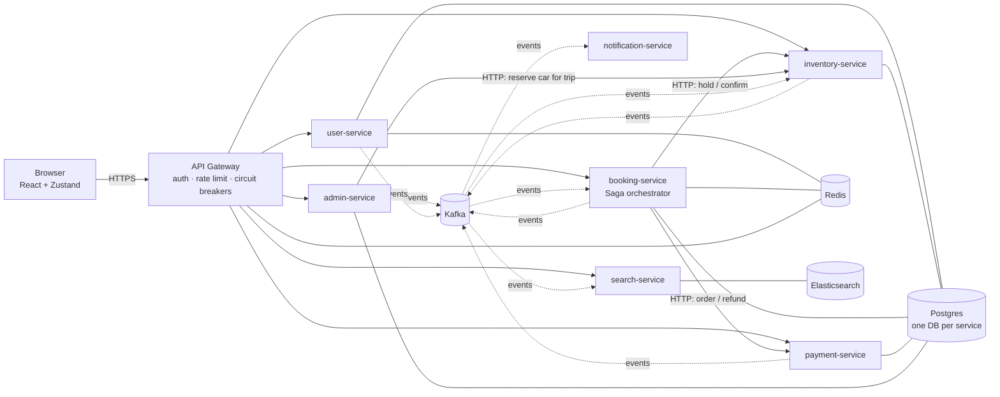

- **Solid arrows** are synchronous HTTP calls: the caller waits for an answer.
- **Dotted arrows** are asynchronous Kafka events. The sender does not know or wait for the receivers.
- Every service owns its own database. Nobody reads another service's tables, so services must
  talk through HTTP or events. That is exactly what makes this a *distributed* system.

---

## 2. Five problems every distributed system has

Every pattern below exists because of one of these problems. Keep this list in mind as you read.

| # | Problem | What goes wrong in SR-CarRentals without care | Patterns that solve it |
|---|---------|-----------------------------------------------|------------------------|
| 1 | **Concurrency**: many processes touch the same data at once | The payment webhook, the expiry job and a user's cancel all change one booking in the same second | **State**, optimistic locking (CAS), distributed lock, DB constraint |
| 2 | **Partial failure**: a call can fail halfway | The car is held in inventory, but creating the payment order fails, so the car stays blocked forever | **Command** (Saga steps with undo), Circuit Breaker, **Decorator** (retries) |
| 3 | **Unreliable messages**: events arrive late, twice, or never | A payment arrives after the booking expired; Kafka redelivers an event | **Observer** + DLQ, idempotency keys, terminal states |
| 4 | **Independent change**: services and vendors evolve separately | Swapping Razorpay for Stripe; adding a third booking type | **Adapter, Facade, Strategy, Factory Method** |
| 5 | **Repeated plumbing**: every service needs the same infrastructure | Four Kafka consumers, each with its own copy of the startup steps, drifting apart | **Template Method, Singleton, Chain of Responsibility** |

### LLD in one page: what you're actually learning

**HLD (High-Level Design)** is the big picture: which services exist, which databases, Kafka, how they
talk (section 1). **LLD (Low-Level Design)** zooms *inside* one service: which **classes/modules**
exist, what each one is responsible for, how they connect, and which **design patterns** keep that
code easy to change. A **class diagram** is the picture of an LLD, and **optimizing** it means
rearranging responsibilities so that a new requirement touches as few classes as possible.

**How to read the arrows in every class diagram below:**

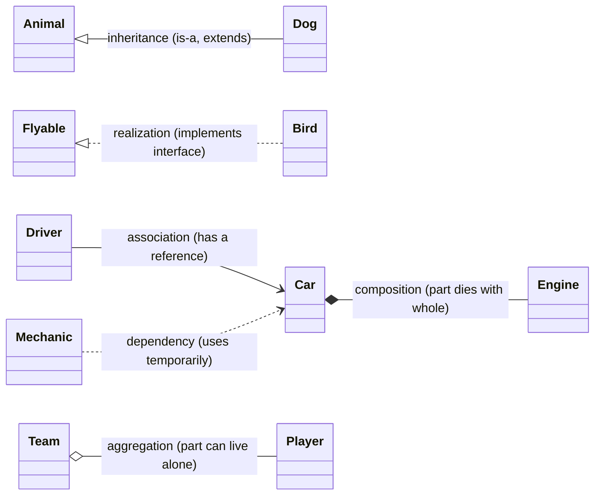

| Arrow | Name | Read it as | Example here |
|-------|------|-----------|--------------|
| `<\|--` | Inheritance | "is a" | `RazorpayGateway` **is a** `BaseGateway` |
| `<\|..` | Realization | "implements" | `RentalStrategy` **implements** the booking-type strategy |
| `*--` | Composition | "owns, and the part dies with it" | a `ServiceEntry` **owns** its `CircuitBreaker` |
| `o--` | Aggregation | "has, but the part can exist alone" | a `RuleGroup` **has** pricing rules |
| `-->` | Association | "keeps a reference to" | `SagaOrchestrator` **holds** commands |
| `..>` | Dependency | "uses for a moment" | `SearchService` **uses** `BoolQueryBuilder` |
| `+` `-` `#` | Visibility | public, private, protected | `-retryMap` is private |
| `<<interface>>` | Stereotype | a role, not a concrete class | `<<interface>> SagaCommand` |

**SOLID: the five principles patterns serve, with examples from this project**

| Principle | Means | Where you can see it |
|-----------|-------|----------------------|
| **S**ingle Responsibility | One class, one reason to change | `CircuitBreaker` only tracks health; `registry.js` only knows where services live; `proxy.js` only forwards |
| **O**pen/Closed | Add features by **adding** code, not editing old code | New booking type = new Strategy; new payment vendor = one line in `CREATORS`; new event = one handler entry |
| **L**iskov Substitution | A subclass must work wherever the parent is expected | Any `BaseGateway` subclass works in `payment.service.js`; any `EventConsumer` subclass works with `start()` |
| **I**nterface Segregation | Small, focused interfaces | `SagaCommand` has 4 methods; a consumer subclass implements only `handlers()` |
| **D**ependency Inversion | Depend on abstractions, not concrete classes | `payment.service.js` depends on `BaseGateway`, never on Razorpay's SDK |

---

## 3. Scorecard — all 23 GoF patterns

**16 of 23 are used.** The other 7 are deliberately not used; section 4–6 explain why.

| # | Pattern | Type | Used? | Where (main file) | Distributed-systems problem it solves |
|---|---------|------|-------|-------------------|---------------------------------------|
| 1 | Singleton | Creational | **Yes** | `*/config/redis.js`, `*/config/prisma.js`, `gateway.factory.js` | One connection pool per process; no connection storms |
| 2 | Factory Method | Creational | **Yes** | `payment-service/.../gateway.factory.js`, `api-gateway/.../proxy.js` (`createProxy`) | Choose the vendor/implementation from config, not code |
| 3 | Builder | Creational | **Yes** | `search-service/src/utils/boolQueryBuilder.js` | Assemble complex Elasticsearch queries from optional filters |
| 4 | Abstract Factory | Creational | No | — | Only one product family exists |
| 5 | Prototype | Creational | No | — | No expensive objects to clone |
| 6 | Adapter | Structural | **Yes** | `razorpay.gateway.js`, gateway `error.middleware.js` | Hide vendor/library quirks behind our own interface |
| 7 | Bridge | Structural | No | — | Only one notification channel (email) |
| 8 | Composite | Structural | No | — | No tree structures |
| 9 | Decorator | Structural | **Yes** | `shared/utils/dlqHandler.js` (`withDLQ`), `asyncHandler.js`, `retryTransaction.js` | Add retries / dead-lettering / error handling without touching business code |
| 10 | Facade | Structural | **Yes** | `booking-service/src/services/inventoryClient.js`, `paymentClient.js` | One simple API in front of HTTP + auth key + retries + timeouts |
| 11 | Flyweight | Structural | No | — | No huge numbers of small objects |
| 12 | Proxy | Structural | **Yes** | `api-gateway/src/services/proxy.js` | Remote proxy that also protects services (breaker, auth) |
| 13 | Chain of Responsibility | Behavioral | **Yes** | `api-gateway/src/routes/index.js` (`authed`, `adminOnly`) | Each request passes auth → role → rate limit; any link can stop it |
| 14 | Command | Behavioral | **Yes** | `booking-service/src/services/saga.service.js` | Each Saga step knows how to **undo** itself |
| 15 | Interpreter | Behavioral | No | — | No custom language to parse |
| 16 | Iterator | Behavioral | **Yes** (language) | `redis.scanStream()` in `user.service.js`; Kafka message stream | Walk huge keyspaces / streams without loading all into memory |
| 17 | Mediator | Behavioral | **Yes** | `saga.service.js` + `booking.service.js` | Inventory and payment never call each other; booking-service coordinates |
| 18 | Memento | Behavioral | No | — | Can't restore another service's DB; we compensate instead |
| 19 | Observer | Behavioral | **Yes** | `shared/utils/eventRouter.js` + Kafka; Zustand stores in the frontend | Services react to events without the publisher knowing them |
| 20 | State | Behavioral | **Yes** | `booking-service/src/services/bookingState.js`, `api-gateway/src/services/circuitBreaker.js` | Only legal status changes, done atomically, so racing processes can't corrupt a booking |
| 21 | Strategy | Behavioral | **Yes** | `booking-service/src/services/holds.js`, gateway `rateLimiting.middleware.js` | RENTAL vs SEAT behaviour; who a rate limit counts against |
| 22 | Template Method | Behavioral | **Yes** | `shared/utils/eventConsumer.js` | Identical consumer startup in 4 services, only handlers differ |
| 23 | Visitor | Behavioral | No | — | Few stable types; operations are added via Strategy |

### All 23 in one line each: the easy way to remember them

| Pattern | One line | Real-life analogy |
|---------|----------|-------------------|
| Singleton | Exactly one instance, shared | The one Wi-Fi router in a house |
| Factory Method | Ask for "a thing"; the factory decides which class | Ordering "a coffee"; the barista picks the machine |
| Abstract Factory | Build a whole matching set | An IKEA furniture collection |
| Builder | Build a complex object step by step | Ordering a custom pizza topping by topping |
| Prototype | Copy an existing object, then tweak it | Photocopying a filled-in form |
| Adapter | Make an incompatible interface fit | A travel plug adapter |
| Bridge | Split two directions of change into two hierarchies | Any remote works with any TV |
| Composite | Treat a group like a single item (tree) | Folders containing files and folders |
| Decorator | Wrap to add behaviour, same interface | Putting a case on a phone |
| Facade | One simple front for a complex system | A hotel reception desk |
| Flyweight | Share the common part of many small objects | One font glyph for every letter "a" |
| Proxy | A stand-in that controls access to the real thing | A security guard at an office |
| Chain of Responsibility | Pass a request along until someone handles or rejects it | Airport check-in → security → boarding gate |
| Command | Turn an action into an object (with undo) | A restaurant order slip |
| Interpreter | Evaluate sentences of a tiny language | A calculator reading `2 + 3 * 4` |
| Iterator | Walk a collection one item at a time | TV remote "next channel" |
| Mediator | Objects talk through a coordinator, not each other | An air-traffic controller |
| Memento | Snapshot state to restore later | A video-game save point |
| Observer | Subscribers get notified of events | YouTube channel subscribers |
| State | Behaviour changes with internal state; only legal moves | A traffic light |
| Strategy | Swap the algorithm behind one interface | Choosing Google Maps' car / bike / walk route |
| Template Method | Fixed recipe; subclasses fill in the steps | A recipe that says "add your choice of filling" |
| Visitor | Add operations to types without editing them | A tax inspector visiting different shops |

---

## 4. Creational patterns

> Creational patterns decide **how objects get created**: who creates them, how many, from what.

### 4.1 Singleton — one shared connection per process ✅

**In plain words.** Make sure a class has **exactly one instance** and give everyone the same one.

**Real-life analogy.** A house has one Wi-Fi router; every device connects to that same router instead of bringing its own.

**Problem.** Each Redis/Postgres/Kafka connection costs sockets and memory on *both* sides. If every
`require()` opened its own client, 8 services × N modules would open hundreds of connections and the
database would refuse new ones under load.

**Solution.** Create the client once and hand out the same instance.

**Where.**
- [`api-gateway/src/config/redis.js`](../api-gateway/src/config/redis.js) and the same file in user and booking services: `RedisClient.getInstance()`.
- [`*/src/config/prisma.js`](../booking-service/src/config/prisma.js): one `PrismaClient` stored on `global`.
- [`payment-service/.../gateway.factory.js`](../payment-service/src/services/gateways/gateway.factory.js): one gateway per process.
- Each Kafka consumer module exports `new XConsumer(...)`, a single instance.

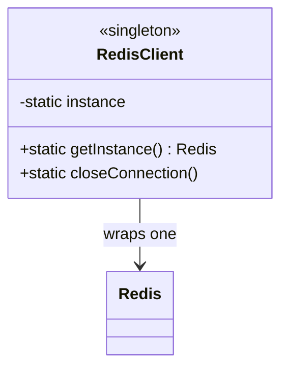

```js
static getInstance() {
     if (!RedisClient.instance) {
          RedisClient.instance = new Redis(config.REDIS_URL, { maxRetriesPerRequest: 3 });
     }
     return RedisClient.instance;
}
```

> **Distributed note.** A Singleton is one per *process*, not one per system. With 3 replicas of
> booking-service you have 3 Redis clients. Anything that must be "only one in the whole cluster"
> (e.g. the expiry job) needs **leader election** (section 7), not a Singleton.

---

### 4.2 Factory Method — pick the implementation from config ✅

**In plain words.** Ask a factory for "a thing" and let **it** decide which concrete class to build.

**Real-life analogy.** You order "a coffee"; the barista decides which machine makes it. You never touch the machine.

**Problem.** `payment.service.js` must create orders and refunds, but it should not care whether
the money moves through Razorpay or Stripe. Calling `new RazorpayGateway()` inside business logic would
weld the two together.

**Solution.** A factory returns "a `BaseGateway`". Which class it builds comes from `PAYMENT_GATEWAY`
in `.env`. Adding Stripe means writing one new class and registering one creator line.

**Where.** [`payment-service/src/services/gateways/gateway.factory.js`](../payment-service/src/services/gateways/gateway.factory.js).
The same idea, a function that builds the right middleware, is used in `createProxy('bookingService')`
and in the `rateLimit({ strategy })` factory in the gateway.

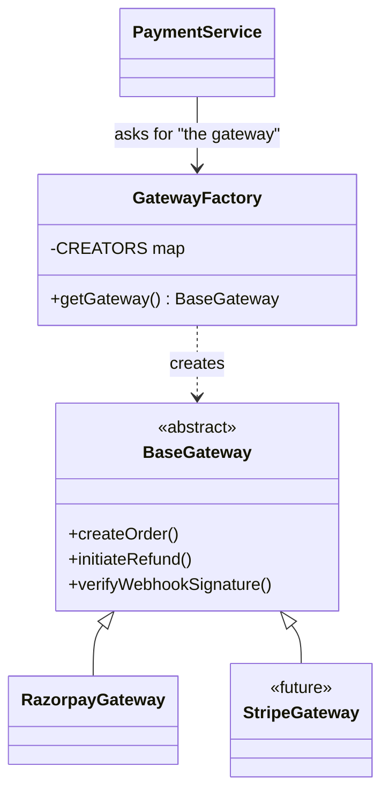

```js
const CREATORS = {
     razorpay: () => new RazorpayGateway(config.RAZORPAY_KEY_ID, config.RAZORPAY_KEY_SECRET, config.RAZORPAY_WEBHOOK_SECRET),
     // stripe: () => new StripeGateway(...),
};
```

---

### 4.3 Builder — assemble complex queries step by step ✅

**In plain words.** Build a complicated object **step by step**, skipping the steps you don't need, then call `build()`.

**Real-life analogy.** Ordering a custom pizza: base, then sauce, then each topping you want. Nothing you didn't ask for ends up on it.

**Problem.** A car search has up to 8 optional filters (city, branch, category, transmission, fuel,
seats, price, dates). Elasticsearch wants one deeply nested JSON object. The old code was a wall of
`if (x) filter.push({...})`, repeated in a different shape in ride search.

**Solution.** A fluent builder. Each step **silently skips an empty value**, so the query reads like
a sentence and `build()` returns the final object.

**Where.** [`search-service/src/utils/boolQueryBuilder.js`](../search-service/src/utils/boolQueryBuilder.js),
used by `searchCars` in `search.service.js` and `searchRides` in `ride.service.js`.

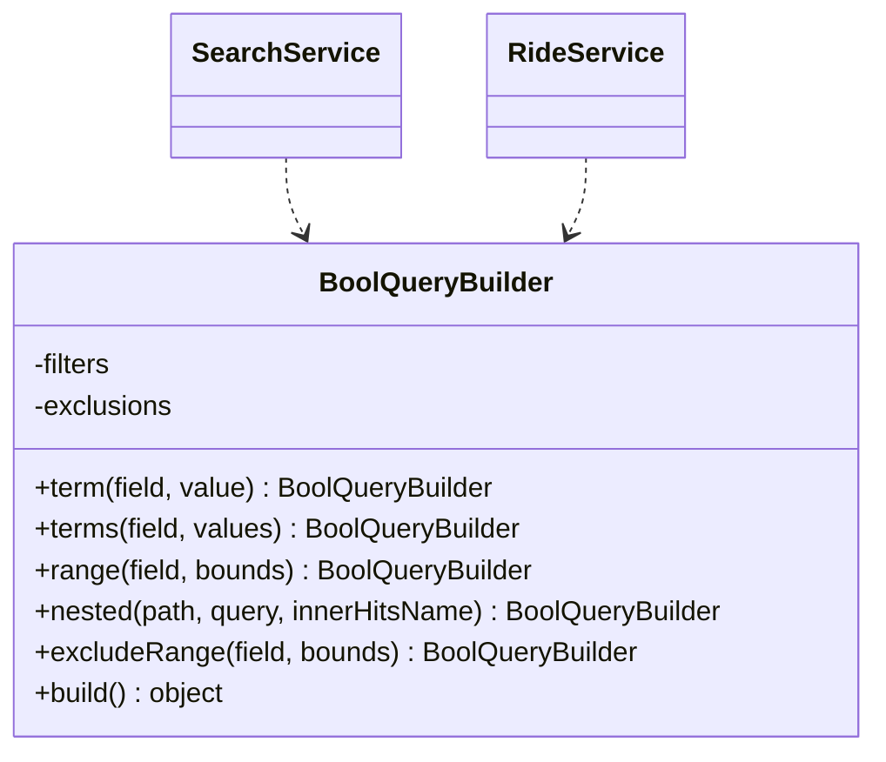

```js
const query = new BoolQueryBuilder()
     .term('status', 'ACTIVE')
     .term('branch.city', resolved.type === 'city' ? resolved.city : undefined)   // skipped if undefined
     .terms('category', upperList(category))
     .range('dailyRate', { lte: maxPrice ? Number(maxPrice) : undefined })
     .excludeRange('blockedRanges', { gte: pickup, lt: dropoff, relation: 'intersects' }) // hide booked cars
     .build();
```

---

### 4.4 Abstract Factory — not used ❌

**In plain words.** A factory that builds a whole **matching set** of objects, so you can never
mix pieces from different sets.

**Real-life analogy.** An IKEA collection: choose "Scandinavian" and you get a matching chair, table
and lamp. You can never end up with a Scandinavian chair next to a Victorian table.

**How it would look here.** Suppose each payment vendor were split into **three separate classes**
that must belong together: one that creates orders, one that refunds, and one that verifies webhooks.
Verifying a Stripe webhook with the Razorpay verifier would be a silent security bug. An abstract
factory ("kit") guarantees you only ever get pieces from the same vendor:

```js
class RazorpayKit {
     createOrderClient()     { return new RazorpayOrderClient(keys); }
     createRefundClient()    { return new RazorpayRefundClient(keys); }
     createWebhookVerifier() { return new RazorpayWebhookVerifier(webhookSecret); }
}
class StripeKit {
     createOrderClient()     { return new StripeOrderClient(keys); }
     createRefundClient()    { return new StripeRefundClient(keys); }
     createWebhookVerifier() { return new StripeWebhookVerifier(webhookSecret); }
}

const kit = config.PAYMENT_GATEWAY === 'stripe' ? new StripeKit() : new RazorpayKit();
const verifier = kit.createWebhookVerifier();   // always matches the orders kit created
```

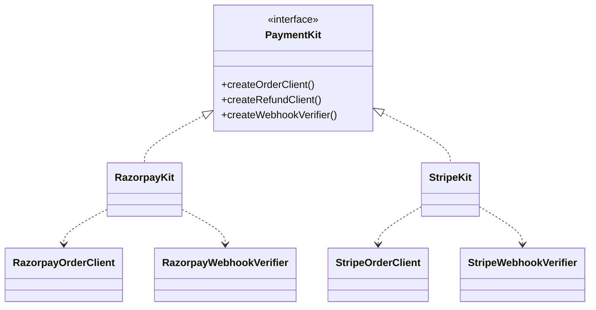

**Why we didn't add it.** Our `RazorpayGateway` is **one** class that does all three jobs, so a
plain Factory Method (4.2) returning one object is enough. There is nothing to mix up.

**When you would add it.** When a vendor integration is split into several collaborating classes,
or when you support two complete "families" side by side (for example a test-mode kit and a live-mode kit).

> **Factory Method vs Abstract Factory:** Factory Method makes **one product**.
> Abstract Factory makes **a family of products** that must match.

---

### 4.5 Prototype — not used ❌

**In plain words.** Make a new object by **copying a ready-made one** and changing only what's different.

**Real-life analogy.** Photocopy a filled-in form, then change only the date.

**How it would look here.** The demo seed script schedules **the same trip every day**: same route,
car, driver and fare, with only the departure date changing. With Prototype you build the trip once
and clone it per day:

```js
const tripPrototype = Object.freeze({ routeId, carId, driverName: 'Ravi', farePerKm: 2.5 });

for (let day = 1; day <= 5; day++) {
     const trip = { ...structuredClone(tripPrototype), departureAt: at(day, '06:00') };
     await scheduleTrip(trip);
}
```

> **Watch out: shallow vs deep copy.** `{ ...trip }` copies only the top level. Nested arrays such as
> `stops` would still be **shared**, so changing one copy's stops changes them all. `structuredClone()`
> makes a deep copy. This is the most common Prototype bug, and a favourite interview question.

**Why we didn't add it as a pattern.** In JavaScript, Prototype is built into the language:
object spread and `structuredClone` already do it. [`scripts/seed-demo.js`](../scripts/seed-demo.js)
informally does exactly this. A formal `clone()` class hierarchy only pays off when objects are
**expensive to construct** (e.g. they load config or open connections), and nothing here is.

**When you would add it.** "Duplicate this route" or "copy last week's schedule" admin features, or
objects that take a lot of work to build.

---

## 5. Structural patterns

> Structural patterns decide **how objects are wired together**: wrapping, hiding, translating.

### 5.1 Adapter — speak our language, not the vendor's ✅

**In plain words.** Wrap something with the "wrong" interface so it fits the interface **your** code expects.

**Real-life analogy.** A travel plug adapter: the Indian charger stays the same; the adapter makes it fit a UK socket.

**Problem.** Razorpay's SDK uses **paise** (₹1 = 100 paise), throws **plain objects instead of `Error`s**,
and has its own field names. If that leaked into `payment.service.js`, every vendor quirk would become
our business logic's problem.

**Solution.** `RazorpayGateway` *adapts* the Razorpay SDK (the "adaptee") to our `BaseGateway`
interface (the "target"). It converts rupees to paise and normalises errors.

**Where.**
- [`payment-service/src/services/gateways/razorpay.gateway.js`](../payment-service/src/services/gateways/razorpay.gateway.js)
- [`api-gateway/src/middlewares/error.middleware.js`](../api-gateway/src/middlewares/error.middleware.js) `toAppError()`
  adapts library errors (body-parser's `entity.parse.failed`) into our `AppError`, so a bad JSON body is
  a **400**, not a 500.

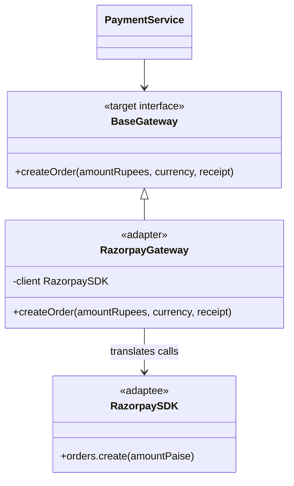

---

### 5.2 Decorator — add behaviour by wrapping ✅

**In plain words.** **Wrap** an object or function to add behaviour, keeping the same interface, so callers can't tell the difference.

**Real-life analogy.** Putting a case on a phone: it's still the same phone with the same buttons, now with extra protection.

**Problem.** Kafka handlers can throw. Without care, a single bad message ("poison pill") is
retried forever and blocks the whole partition. We need retry counting and a dead-letter queue,
but we don't want that code inside every handler.

**Solution.** Wrap the handler. `withDLQ(handler)` returns a function with the *same signature* that
adds: parse JSON → call handler → on failure count attempts → after N attempts publish to a DLQ topic
and move on. The handler itself never knows.

**Where.**
| Decorator | Wraps | Adds |
|-----------|-------|------|
| [`shared/utils/dlqHandler.js`](../shared/utils/dlqHandler.js) `withDLQ` | every Kafka handler | retry count + dead-letter queue |
| [`*/utils/asyncHandler.js`](../user-service/src/utils/asyncHandler.js) | every Express controller | forwards async errors to the error middleware |
| [`inventory-service/src/utils/retryTransaction.js`](../inventory-service/src/utils/retryTransaction.js) | DB transactions | retry on deadlock / lock-not-available |
| `withRetry` in [`booking-service/.../inventoryClient.js`](../booking-service/src/services/inventoryClient.js) | HTTP calls | exponential backoff, but **never** retries 4xx |

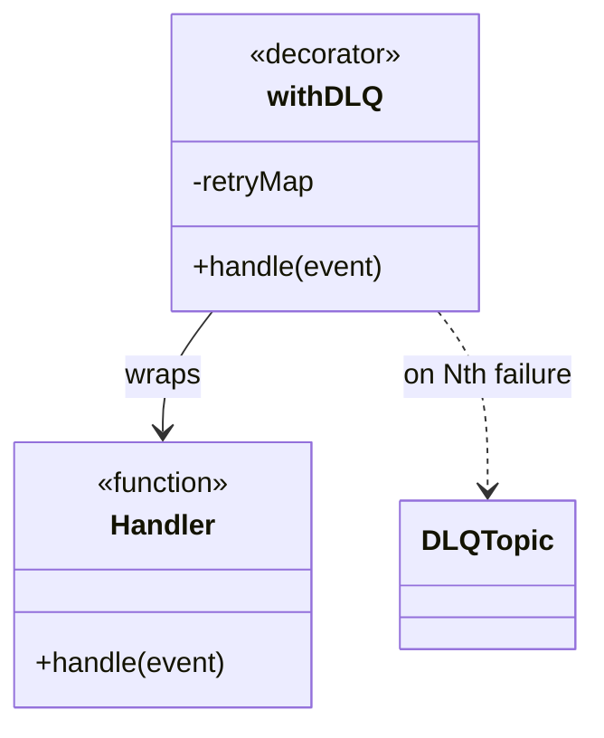

---

### 5.3 Facade — one simple door in front of a complicated room ✅

**In plain words.** Give a complicated subsystem **one simple front door**.

**Real-life analogy.** A hotel reception desk: you ask for "a room"; you never deal with housekeeping, billing and maintenance yourself.

**Problem.** Calling inventory-service from booking-service involves a base URL, a timeout, the
secret `x-internal-service-key` header, retries with backoff, and turning HTTP errors into our errors.
Doing that at every call site would be error-prone.

**Solution.** `inventoryClient.holdCar(...)`, `paymentClient.createPaymentOrder(...)`. Callers see
one method. The facade hides HTTP entirely.

**Where.** [`booking-service/src/services/inventoryClient.js`](../booking-service/src/services/inventoryClient.js),
[`paymentClient.js`](../booking-service/src/services/paymentClient.js),
[`userClient.js`](../booking-service/src/services/userClient.js),
[`admin-service/src/services/inventoryClient.js`](../admin-service/src/services/inventoryClient.js).

---

### 5.4 Proxy — stand in for the real service ✅

**In plain words.** A **stand-in** object with the same interface as the real one, which controls access to it (security, remote access, caching).

**Real-life analogy.** A security guard at an office: visitors talk to the guard, who checks ID before letting anyone reach the real office.

**Problem.** The browser must not reach 7 services directly. That would mean 7 public URLs, 7 CORS
setups and 7 JWT checks, and no single place to stop a flood of requests.

**Solution.** The API Gateway is a **remote proxy**: it has the same paths as the services
(`/api/bookings/...` → booking-service `/bookings/...`) and forwards requests. It is also a
**protection proxy**: it verifies the JWT, strips spoofed `x-user-id` headers, and refuses to call a
service whose circuit breaker is open.

**Where.** [`api-gateway/src/services/proxy.js`](../api-gateway/src/services/proxy.js) `createProxy()`.

---

### 5.5 Bridge — not used (yet) ❌

**In plain words.** When something varies in **two independent directions**, make two separate
hierarchies and connect them with a reference (the "bridge"), instead of one class per combination.

**Real-life analogy.** TV remotes and TVs. A remote (basic or advanced) works with any TV brand
(Sony or LG). You don't buy a "Sony-advanced-remote" and an "LG-advanced-remote" separately.

**How it would look here.** Notifications vary in two ways:
- **what** we say: OTP, booking confirmed, booking cancelled, …
- **how** we deliver it: Email, SMS, WhatsApp, …

Without Bridge you'd write one class per combination: 3 messages × 3 channels = **9 classes**, and a
4th channel adds 3 more. With Bridge it's 3 + 3 = **6 classes**, and a 4th channel adds **1**.

```js
// Implementation side: HOW to deliver
class EmailChannel { send(user, msg) { return sendgrid.send({ to: user.email, subject: msg.subject, html: msg.html }); } }
class SmsChannel   { send(user, msg) { return smsApi.send({ to: user.phone, text: msg.text }); } }

// Abstraction side: WHAT to say. It holds a channel; that reference is the bridge.
class Notification {
     constructor(channel) { this.channel = channel; }
     notify(user, data)   { return this.channel.send(user, this.render(data)); }
}
class BookingConfirmed extends Notification {
     render(b) {
          return {
               subject: `Booking confirmed: ${b.carName}`,
               html: `<p>Your ${b.carName} is booked …</p>`,
               text: `SR-CarRentals: ${b.carName} booked for ${b.pickupAt}`,
          };
     }
}

new BookingConfirmed(new SmsChannel()).notify(user, booking);   // any message × any channel
```

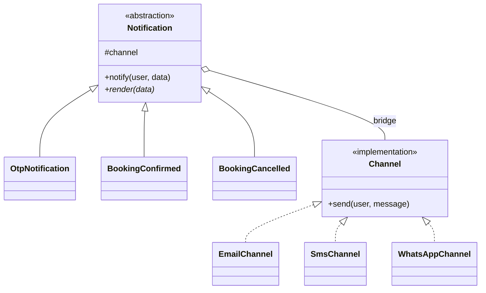

**Why we didn't add it.** There is only **one** channel today (email via SendGrid), so there is only
one direction of change. A bridge to a single implementation is ceremony.

**When you would add it.** As soon as a second channel (SMS OTP, WhatsApp booking alerts) is planned.
That moment is listed in [section 12](#12-known-limits-and-next-steps).

> **Bridge vs Strategy:** they look alike (an object holding a swappable helper). Bridge is about
> **two hierarchies growing independently**; Strategy is about **swapping one algorithm**.

---

### 5.6 Composite — not used ❌

**In plain words.** Treat **a group of things exactly like a single thing**. Groups can contain other
groups, which forms a tree, and you call the same method on a leaf or on a whole group.

**Real-life analogy.** A folder's size is the sum of its files and sub-folders. You call `size()` on a
file or on a folder; you don't care which it is.

**How it would look here.** Pricing today has exactly two fixed rules in
[`booking-service/src/utils/pricing.js`](../booking-service/src/utils/pricing.js): bill every started
24 h block, and give 10 % off for 7+ days. Imagine marketing wants **stackable offers**: weekend
surcharge, festival coupon, and a "corporate bundle" that is itself a group of rules. Composite lets a
group of rules behave like one rule:

```js
class LongRentalDiscount { apply(price, ctx) { return ctx.days >= 7 ? price * 0.9 : price; } }
class WeekendSurcharge   { apply(price, ctx) { return ctx.isWeekend ? price * 1.15 : price; } }
class Coupon             { constructor(pct) { this.pct = pct; } apply(price) { return price * (1 - this.pct / 100); } }

class RuleGroup {                                   // the composite
     constructor(rules) { this.rules = rules; }
     apply(price, ctx)  { return this.rules.reduce((p, rule) => rule.apply(p, ctx), price); }
}

const corporateBundle = new RuleGroup([new Coupon(5), new LongRentalDiscount()]);
const pricing = new RuleGroup([new WeekendSurcharge(), corporateBundle]);   // a group inside a group
pricing.apply(4000, { days: 8, isWeekend: true });
```

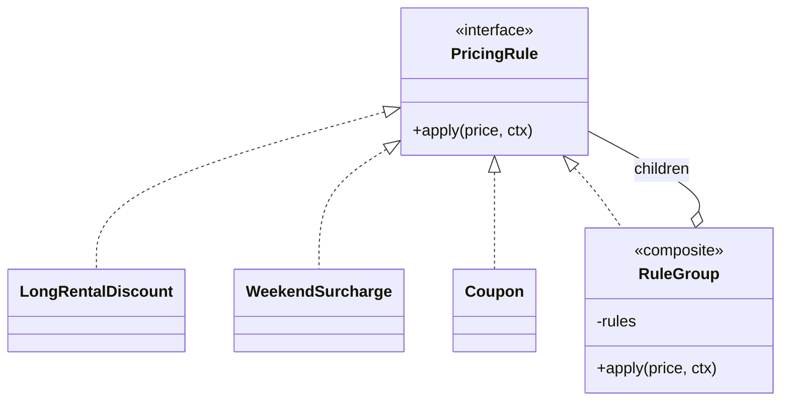

Another natural tree in this domain is **region → city → branch → car**: "how many cars are free in
South India?" would be `region.countFreeCars()`, summing down the tree.

**Why we didn't add it.** Two fixed rules don't need a tree. A plain function is clearer, and the
pricing code is tested as pure functions.

**When you would add it.** When rules become data configured by admins and can be nested or combined.

---

### 5.7 Flyweight — not used ❌

**In plain words.** When you have **huge numbers of small objects**, store the part they all share
**once**, and keep only the part that differs in each object.

**Real-life analogy.** A text editor stores what the letter "a" looks like (its font glyph) once,
not once for every "a" on the page. Each character only remembers its position.

**How it would look here.** Imagine SR-CarRentals grows into **50-seat buses × 10,000 trips** =
500,000 seat objects. Each seat's *type* (window/aisle, icon, legroom text, extra fee) is identical
across thousands of seats. Share it:

```js
// Shared, immutable "intrinsic" state: created once
const SEAT_TYPES = {
     WINDOW: Object.freeze({ label: 'Window', icon: '/icons/seat-window.svg', extraFee: 50 }),
     AISLE:  Object.freeze({ label: 'Aisle',  icon: '/icons/seat-aisle.svg',  extraFee: 0 }),
};

// Per-seat "extrinsic" state: only what differs
const seats = Array.from({ length: 50 }, (_, i) => ({
     number: i + 1,
     type: i % 4 === 0 || i % 4 === 3 ? SEAT_TYPES.WINDOW : SEAT_TYPES.AISLE,   // a reference, not a copy
}));
```

You already benefit from Flyweight-like sharing without writing it: all cars of the same model point
to the **same image URL** (`/cars/<model>.jpg`), so the browser downloads and caches each photo once.

**Why we didn't add it.** A car has at most 7 passenger seats and a seat map is built per request.
There's no memory problem to solve, and Flyweight makes code harder to read.

**When you would add it.** Large in-memory collections such as maps, seat layouts for big vehicles,
or caching thousands of search results.

---

## 6. Behavioral patterns

> Behavioral patterns decide **who does what, and how objects talk**.

### 6.1 Chain of Responsibility — a request passes through checkpoints ✅

**In plain words.** Pass a request along a **chain of handlers**; each one either handles or rejects it, or passes it on.

**Real-life analogy.** Airport: check-in → security → boarding gate. Any of them can stop you; if all say yes, you fly.

**Problem.** An admin request must be authenticated, then role-checked, then rate-limited, then proxied.
Any step may reject it with its own error.

**Solution.** Express middleware is a chain: each link either calls `next()` or stops with an error.
Named chains (`authed`, `adminOnly`) make the policy of every route readable at a glance.

**Where.** [`api-gateway/src/routes/index.js`](../api-gateway/src/routes/index.js).

```js
const authed    = [requireAuth, userRateLimit()];               // limited per user, not per IP
const adminOnly = [requireAuth, requireAdmin, userRateLimit()];

router.patch('/admins/cars/car/:carId/status', ...adminOnly, adminServiceProxy);
```

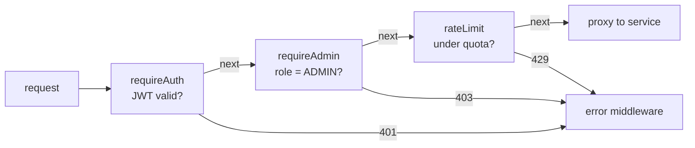

---

### 6.2 Command — every Saga step knows how to undo itself ✅

**In plain words.** Turn an **action into an object**, so it can be stored, logged, queued and **undone**.

**Real-life analogy.** A restaurant order slip: the waiter writes it down, the kitchen executes it, and it can be cancelled before it's cooked.

**Problem (partial failure).** Booking a car is three calls to two other services:
**hold the car → create the payment order → confirm the car**. There is no database transaction across
services. If step 2 fails, step 1 has already happened in *another* database and must be undone.

**Solution.** Each step is a **command object** with `execute()` and `compensate()` (undo). The saga
orchestrator (the "invoker") runs commands, records each one in the `SagaLog` table, and on failure
walks the log **backwards** calling `compensate()`. It doesn't need to know what any step does.

**Where.** [`booking-service/src/services/saga.service.js`](../booking-service/src/services/saga.service.js).

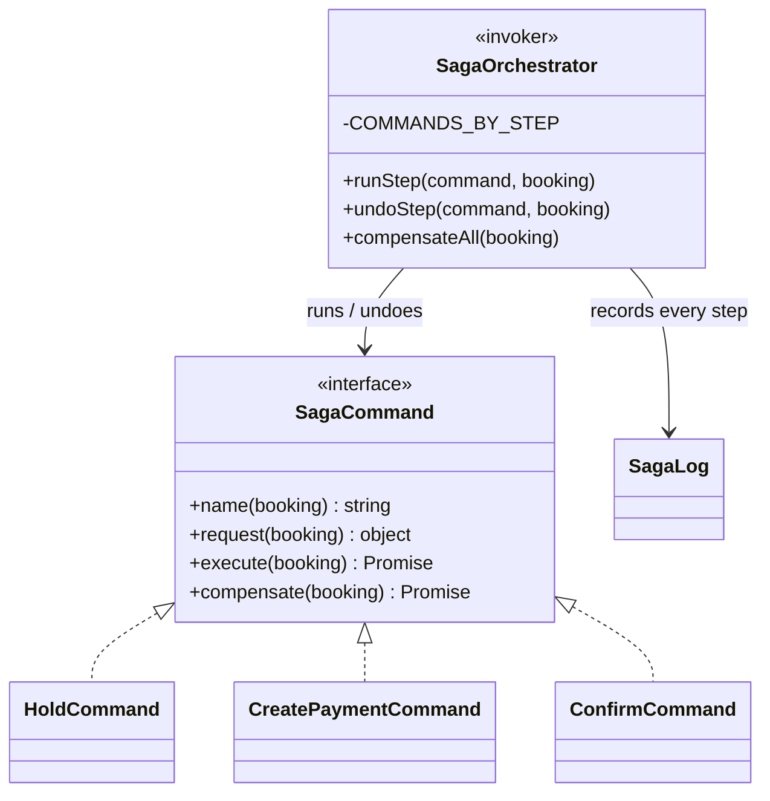

| Command | `execute()` | `compensate()` |
|---------|-------------|----------------|
| `HoldCommand` | hold car / seats in inventory (with TTL) | release the hold |
| `CreatePaymentCommand` | create Razorpay order | refund if anything was paid |
| `ConfirmCommand` | turn the hold into a booking | cancel the reservation |

```js
async function compensateAll(booking) {
     const completedSteps = await prisma.sagaLog.findMany({
          where: { bookingId: booking.id, status: 'COMPLETED' },
          orderBy: { createdAt: 'desc' },              // newest first = reverse order
     });
     for (const { step } of completedSteps) {
          const command = COMMANDS_BY_STEP[step];       // was a switch statement
          if (command) await undoStep(command, booking);
     }
}
```

---

### 6.3 Iterator — walk big collections lazily ✅ (language level)

**In plain words.** Walk through a collection **one item at a time**, without knowing how it's stored.

**Real-life analogy.** The "next channel" button on a TV remote: you never need to know how channels are stored inside.

JavaScript has Iterator built in (`for … of`, `for await … of`). We use it where loading everything
at once would be wrong:
- Deleting an account revokes every device session with `for await (const keys of redis.scanStream(...))`
  in [`user-service/src/services/user.service.js`](../user-service/src/services/user.service.js).
  `SCAN` walks the keyspace in pages; `KEYS *` would freeze Redis.
- A Kafka consumer is an endless iterator over a partition's messages.

---

### 6.4 Mediator — services don't call each other, one coordinator does ✅

**In plain words.** Objects talk to **one coordinator** instead of to each other, which turns a tangle of links into a star.

**Real-life analogy.** Air-traffic control: planes never radio each other; they all talk to the tower.

**Problem.** If inventory-service called payment-service and payment-service called inventory-service,
you'd get a tangle where every service knows every other one.

**Solution.** booking-service is the **mediator** (the saga orchestrator). Inventory and payment never
talk to each other; each only talks to booking-service. Kafka plays a similar role for events: a
publisher talks to the broker, never to the consumers.

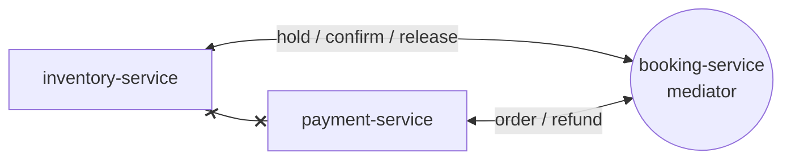

---

### 6.5 Observer — react to events without knowing who sent them ✅

**In plain words.** When something happens, **all subscribers are notified automatically**; the publisher doesn't know who they are.

**Real-life analogy.** YouTube subscriptions: the creator uploads once, and every subscriber gets notified.

**Problem.** When an admin deactivates a car, inventory must stop selling it, search must hide it,
booking must cancel and refund affected bookings, and notification must email customers.
If admin-service called all four, it would break whenever one is down, and it would have to change
every time someone new cares about cars.

**Solution.** admin-service **publishes** `admin.car-status-changed` to Kafka and forgets about it.
Each interested service **subscribes** and runs its own handler. New observers can be added without
touching the publisher.

**Where.** [`shared/utils/eventRouter.js`](../shared/utils/eventRouter.js). Each service registers
one handler per topic, and the **handler map is the only list of topics**, so "subscribed but not
handled" or "handled but never subscribed" can't happen. That bug was possible before, when the
subscribe list and the `switch` were separate.

```js
handlers() {
     return {
          [KAFKA_TOPICS.PAYMENT_SUCCESS]: (e) => bookingService.handlePaymentSuccess(e.paymentOrderId),
          [KAFKA_TOPICS.PAYMENT_FAILED]:  (e) => bookingService.handlePaymentFailure(e.paymentOrderId, e.reason),
          [KAFKA_TOPICS.TRIP_CANCELLED]:  (e) => bookingService.handleTripCancelled(e.tripId, e.reason),
     };
}
```

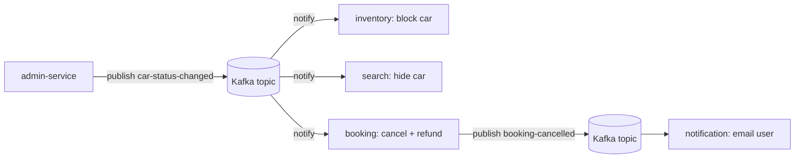

Also in the frontend: Zustand stores (`theme.store.js`, `booking.store.js`) are observable subjects.
Components re-render when the state they subscribe to changes.

> **Distributed note.** Kafka delivers **at least once**, so a handler may see the same event twice.
> Every handler is therefore **idempotent**. For example, `handlePaymentSuccess` returns early if the
> booking is already `CONFIRMED`.

---

### 6.6 State — only legal status changes, and only one winner ✅ ⭐

**In plain words.** An object behaves differently depending on its **current state**, and only **allowed state changes** can happen.

**Real-life analogy.** A traffic light: it can go green → yellow → red, never green → red directly, and what cars may do depends on the colour.

This is the most important pattern in the project for distributed correctness.

**Problem.** Up to **five independent processes** can change the same booking at the same moment:

1. the saga still creating it,
2. the Razorpay webhook (payment succeeded or failed),
3. the expiry job (payment window passed),
4. the user pressing *Cancel*,
5. an admin withdrawing the car or trip.

Before the refactor, status rules were string lists scattered across 4 files, and some writes were
**unconditional** `UPDATE ... SET status = 'CAR_HELD'`. Real bug: if an admin cancelled a booking
while its saga was still running, the saga's next step wrote `CAR_HELD` over `CANCELLED` and brought
the booking back to life.

**Solution.**
1. One **transition table** says which moves are legal.
2. Every write goes through `transition()`, which performs the check and the write in **one atomic SQL
   statement**: `UPDATE booking SET status = $to WHERE id = $id AND status IN ($allowedFrom) [AND version = $v]`.
   If two processes race, Postgres lets exactly one row-update succeed. The loser sees `count = 0`
   and backs off (or compensates).

**Where.** [`booking-service/src/services/bookingState.js`](../booking-service/src/services/bookingState.js).

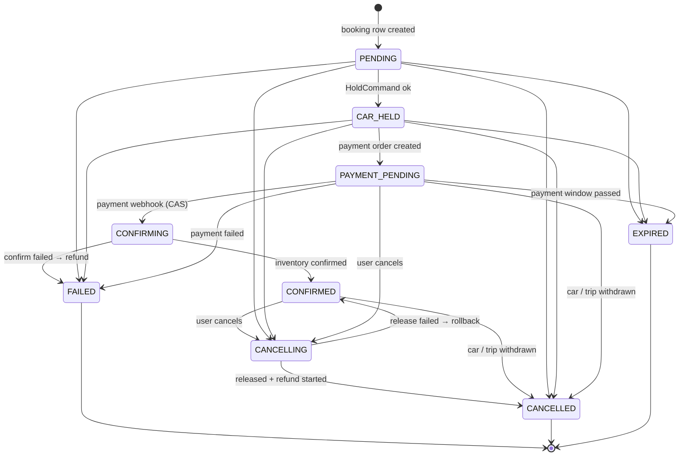

```js
const TRANSITIONS = {
     PENDING:         ['CAR_HELD', 'FAILED', 'EXPIRED', 'CANCELLING', 'CANCELLED'],
     CAR_HELD:        ['PAYMENT_PENDING', 'FAILED', 'EXPIRED', 'CANCELLING', 'CANCELLED'],
     PAYMENT_PENDING: ['CONFIRMING', 'FAILED', 'EXPIRED', 'CANCELLING', 'CANCELLED'],
     CONFIRMING:      ['CONFIRMED', 'FAILED'],
     CONFIRMED:       ['CANCELLING', 'CANCELLED'],
     CANCELLING:      ['CANCELLED', 'CONFIRMED'],
     FAILED: [], CANCELLED: [], EXPIRED: [],          // terminal
};

async function transition(bookingId, to, { from, version, data }) {
     // 1. programming error? (table forbids it) → throw immediately
     // 2. race? → one atomic UPDATE ... WHERE status IN (from) [AND version = v]
     const result = await prisma.booking.updateMany({
          where: { id: bookingId, status: { in: [].concat(from) }, ...(version !== undefined && { version }) },
          data: { ...data, status: to, version: { increment: 1 } },
     });
     return result.count === 1;   // true = this caller won
}
```

**Second State machine: the circuit breaker.**
[`api-gateway/src/services/circuitBreaker.js`](../api-gateway/src/services/circuitBreaker.js)

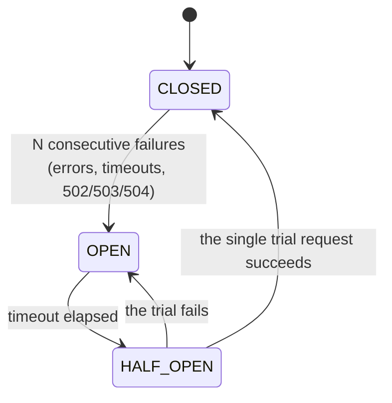

While `OPEN`, the gateway answers **503 immediately** instead of making users wait 60 s for a dead
service, and the dead service gets time to recover instead of being hammered.

---

### 6.7 Strategy — same job, different algorithm, chosen at runtime ✅

**In plain words.** Several interchangeable **algorithms behind one interface**; pick one at runtime.

**Real-life analogy.** Google Maps: same "get directions" button, but you choose car, bike or walking. Each is a different route algorithm.

**Problem.** A rental holds a *whole car for a time window*; a seat booking holds *specific seats for a
stretch of stops*. The saga, the expiry job and cancellation all need "hold / release / confirm / cancel",
and before the refactor each of those had an `isSeat ? ... : ...` ternary.

**Solution.** One strategy object per booking type with the same methods. Flows call
`strategyFor(booking).placeHold(booking)`. A third type (say, airport transfer) means one new object,
not edits across the codebase.

**Where.**
- [`booking-service/src/services/holds.js`](../booking-service/src/services/holds.js): `RentalStrategy`, `SeatStrategy`.
- [`api-gateway/src/middlewares/rateLimiting.middleware.js`](../api-gateway/src/middlewares/rateLimiting.middleware.js):
  key strategies `ip`, `user`, `endpoint` decide **who** a request is counted against. The sliding-window
  algorithm itself is shared.
- Payment: `BaseGateway` is the strategy interface; the factory picks the concrete one.

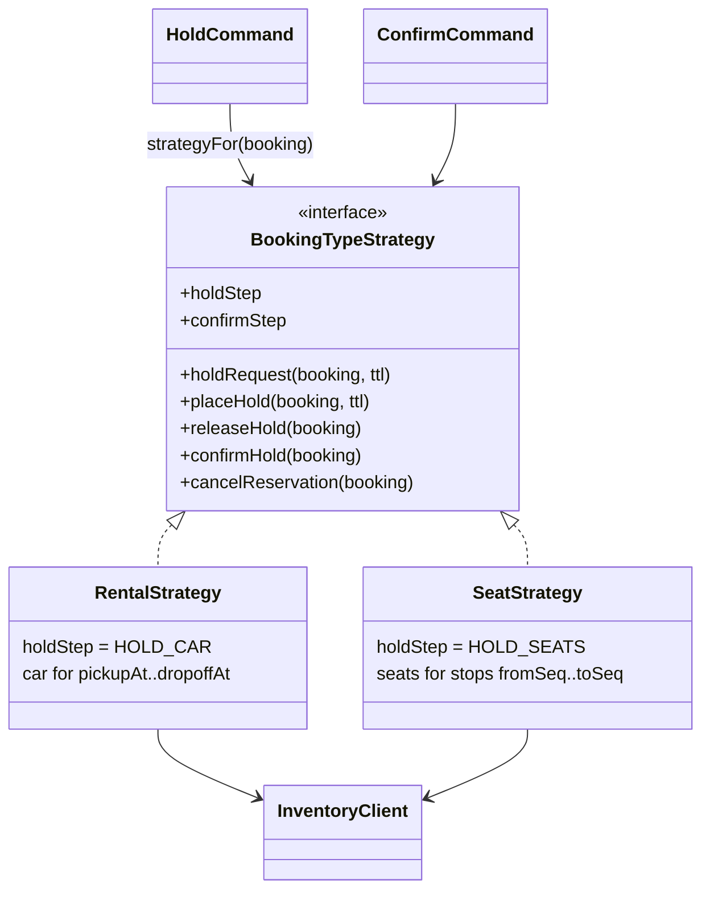

> **Strategy vs State: they look the same, so what's the difference?** Both swap behaviour behind
> one interface. With **Strategy** the *caller* picks the behaviour and it doesn't change by itself
> (a rental stays a rental). With **State** the object *moves between* behaviours as events happen
> (PENDING → CONFIRMED).

---

### 6.8 Template Method — fixed skeleton, customisable steps ✅

**In plain words.** A base class fixes the **order of the steps** (the recipe); subclasses fill in only the steps that differ.

**Real-life analogy.** A sandwich recipe: "bread → your filling → bread → toast". Everyone follows the order; only the filling changes.

**Problem.** Four services consume Kafka, and each had a hand-written copy of the same startup:
create topics → connect → connect DLQ producer → subscribe → run with DLQ. The order matters (topics
must exist before subscribing; the DLQ producer must be connected before the first message can fail),
and the copies had already started to drift.

**Solution.** An abstract `EventConsumer` whose `start()` is the **template method**, a fixed sequence.
Subclasses only fill in **hooks**: `handlers()` (required) and `beforeConnect()` (optional).
search-service uses `beforeConnect` to replay Kafka history when it rebuilds its index.

**Where.** [`shared/utils/eventConsumer.js`](../shared/utils/eventConsumer.js).

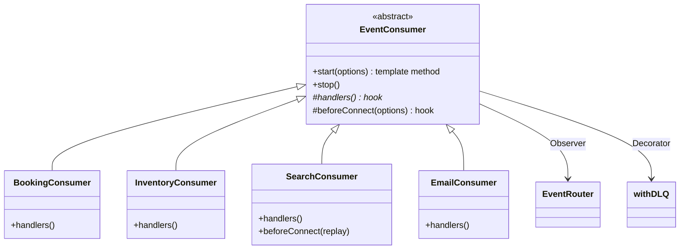

```js
async start(options = {}) {                       // the template: subclasses can't reorder it
     const router = createEventRouter(this.handlers(), this.logger);   // hook
     await ensureTopics(this.kafka, this.logger);
     await this.beforeConnect(options);                                // hook
     await this.consumer.connect();
     await this.connectProducer();
     await this.consumer.subscribe({ topics: router.topics, fromBeginning: this.fromBeginning });
     await this.consumer.run({ eachMessage: withDLQ(this.producer, this.dlqTopic, this.logger, router.dispatch) });
}
```

---

### 6.9 Interpreter — not used ❌

**In plain words.** Define a **tiny language** (its grammar) and a class for each rule of that grammar,
then evaluate sentences written in it.

**Real-life analogy.** A calculator that understands `2 + 3 * 4`, or Gmail's search box understanding
`from:boss has:attachment`.

**How it would look here.** A power-user search box for admins:
`city:hyderabad seats>=5 fuel:EV price<=3000`. Each `field op value` is an expression. The interpreter
turns them into the Builder calls we already have (4.3):

```js
// Grammar:  query := term (" " term)*     term := field op value     op := ":" | ">=" | "<="
const FIELDS = { city: 'branch.city', seats: 'seats', fuel: 'fuelType', price: 'dailyRate' };

const parse = (text) => text.trim().split(/\s+/)
     .map((t) => t.match(/^(\w+)(>=|<=|:)(.+)$/))
     .filter(Boolean)
     .map(([, field, op, value]) => ({ field: FIELDS[field], op, value }));

const interpret = (terms, builder) => terms.reduce((b, { field, op, value }) =>
     op === ':' ? b.term(field, value)
                : b.range(field, { [op === '>=' ? 'gte' : 'lte']: Number(value) }), builder);

const query = interpret(parse('seats>=5 fuel:EV price<=3000'), new BoolQueryBuilder()).build();
```

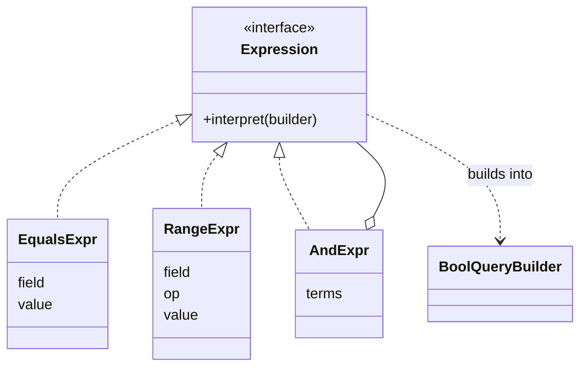

**Why we didn't add it.** Customers use dropdowns and date pickers, which arrive as plain query
parameters. There is no language to interpret.

**When you would add it.** Admin power search, a rules engine ("if city = Goa and month = Dec then
surcharge 20 %"), or saved alert filters.

---

### 6.10 Memento — not used, and why that's interesting ❌

**In plain words.** Take a **snapshot** of an object's state so you can **restore** it later, without
exposing its internals.

**Real-life analogy.** A save point in a video game. You can return to it, but you can't edit what's
inside the save file.

**How it would look here (where it *does* fit: inside one process).** On the seat-selection page, a
user picks seats, then changes their boarding stop, which would clear the selection. If they press
"Back", we restore exactly what they had:

```js
class SeatSelection {
     #seats = new Set();                     // private: outsiders can't touch it
     toggle(n) { this.#seats.has(n) ? this.#seats.delete(n) : this.#seats.add(n); }
     save()    { return Object.freeze({ seats: [...this.#seats] }); }   // the memento
     restore(m) { this.#seats = new Set(m.seats); }
}

const snapshot = selection.save();   // before changing the stretch
// … user changes stretch, selection gets cleared …
selection.restore(snapshot);         // user pressed Back
```

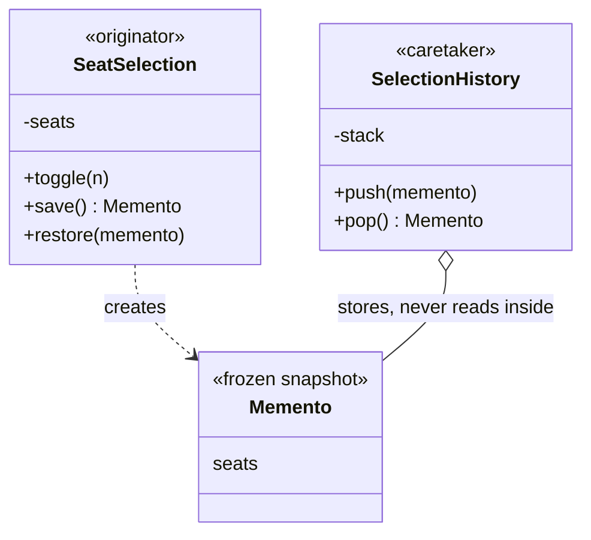

**Why it doesn't work for the backend: the key distributed-systems lesson.** In a distributed system
you **cannot restore another service's database** to a snapshot. Between "hold the car" and "payment
failed", other customers may have booked other dates on that same car. Restoring an old snapshot would
erase their bookings. Instead we **compensate**: perform a *new* action that semantically undoes ours
(release *our* hold, refund *our* payment). That is the Saga's Command + compensate design (6.2), the
distributed answer to the problem Memento solves in a single process.

---

### 6.11 Visitor — not used ❌

**In plain words.** Put a **new operation outside the classes it works on**. Each class has one
`accept(visitor)` method that calls the visitor's method for *its* type ("double dispatch").

**Real-life analogy.** A tax inspector visiting different shops. The inspector knows how to inspect a
restaurant versus a garage; each shop only has to let the inspector in.

**How it would look here.** Two booking types (Rental, Seat) and a growing list of operations: invoice
text, refund calculation, analytics export, PDF ticket. With Visitor, all the **invoice** code lives in
one visitor, and all the **export** code in another:

```js
class RentalBooking { accept(visitor) { return visitor.visitRental(this); } }
class SeatBooking   { accept(visitor) { return visitor.visitSeat(this); } }

const invoiceLine = {
     visitRental: (b) => `Rental · ${b.carName} · ${b.rentalDays} day(s) × ₹${b.dailyRate}`,
     visitSeat:   (b) => `Shared ride · seats ${b.seatNumbers.join(', ')} · ${b.fromStopName} → ${b.toStopName}`,
};
const csvExport = {
     visitRental: (b) => [b.id, 'RENTAL', b.totalAmount].join(','),
     visitSeat:   (b) => [b.id, 'SEAT', b.totalAmount].join(','),
};

booking.accept(invoiceLine);
booking.accept(csvExport);
```

```mermaid
classDiagram
    class BookingVisitor {
        <<interface>>
        +visitRental(booking)
        +visitSeat(booking)
    }
    class InvoiceVisitor
    class CsvExportVisitor
    class Booking {
        <<interface>>
        +accept(visitor)
    }
    class RentalBooking
    class SeatBooking
    BookingVisitor <|.. InvoiceVisitor
    BookingVisitor <|.. CsvExportVisitor
    Booking <|.. RentalBooking
    Booking <|.. SeatBooking
    Booking ..> BookingVisitor : accept calls visitX
```

**Visitor vs the Strategy we used: when to choose which.**

| | Strategy (what we did, 6.7) | Visitor |
|---|---|---|
| Code is grouped by… | **type** (everything about rentals in `RentalStrategy`) | **operation** (everything about invoices in `InvoiceVisitor`) |
| Cheap to add… | a new **type** (one new strategy) | a new **operation** (one new visitor) |
| Expensive to add… | a new operation (edit every strategy) | a new type (edit every visitor) |

**Why we didn't add it.** Our bookings are plain database rows from Prisma, not class instances with
an `accept()` method. Booking *types* are what grows here (rentals, seats, maybe airport transfers),
which favours Strategy.

**When you would add it.** When types are stable but reports and exports keep multiplying, e.g. an
accounting/analytics module.

---

## 7. Distributed-systems patterns (beyond GoF)

GoF patterns are about objects in **one** process. These patterns are about **many processes**, and
they carry most of the load in SR-CarRentals.

| Pattern | Where | In one sentence |
|---------|-------|-----------------|
| **API Gateway** | `api-gateway/` | One public entry point that does auth, rate limiting and routing. |
| **Service Registry** | [`api-gateway/src/services/registry.js`](../api-gateway/src/services/registry.js) | One table of services, their URLs and their circuit breakers. |
| **Circuit Breaker** | [`circuitBreaker.js`](../api-gateway/src/services/circuitBreaker.js) | Stop calling a failing service; fail fast; probe with one request. |
| **Saga (orchestration)** | [`saga.service.js`](../booking-service/src/services/saga.service.js) | A multi-service "transaction" made of steps with compensations. |
| **Database per service** | each `prisma/schema.prisma` | Services own their data; nobody joins across services. |
| **Event-driven + CQRS** | Kafka → search-service | Writes happen in Postgres; Elasticsearch is a read-optimised copy fed by events. |
| **Event replay** | `SearchConsumer.beforeConnect` | The search index can be rebuilt from Kafka history at any time. |
| **Dead Letter Queue** | [`dlqHandler.js`](../shared/utils/dlqHandler.js) | Poison messages are parked so the partition keeps flowing. |
| **Idempotency key** | `checkIdempotency` in `booking.service.js` | Retrying "Pay" never creates two bookings. |
| **Optimistic locking (CAS)** | `version` column + `transition()` | Write only if nobody changed the row since you read it. |
| **Distributed lock** | [`distributedLock.js`](../booking-service/src/utils/distributedLock.js) (Redis + Lua) | Only one request may book a given car window / seat at a time. |
| **DB exclusion constraint** | [`dbConstraints.js`](../inventory-service/src/config/dbConstraints.js) | Postgres itself refuses overlapping holds: the last line of defence. |
| **Leader election** | `bookingExpiry.js` (Redis `SET NX`), `lockExpiry.js` (`pg_try_advisory_lock`) | With N replicas, exactly one runs the cleanup job. |
| **Cache-Aside** | [`user.service.js`](../user-service/src/services/user.service.js) | Read Redis first; on writes, delete the cached copy. |
| **Refresh-token rotation + reuse detection** | `auth.service.js` (Lua compare-and-swap) | A stolen, replayed refresh token kills the session. |

**Why three layers against double booking?** Each catches what the one before can miss:

```mermaid
flowchart TB
    R[Two users click Book for the same car + dates] --> L1
    L1[1. Redis Lua lock<br/>fast, rejects most duplicates in ~1 ms] -->|lock expired / Redis restarted| L2
    L2[2. SELECT ... FOR UPDATE NOWAIT + overlap check<br/>serialises writers on the car row] -->|bug in a code path| L3
    L3[3. Postgres EXCLUDE constraint<br/>tsrange overlap is physically impossible]
```

---

## 8. One booking, end to end, with every pattern labelled

```mermaid
sequenceDiagram
    autonumber
    participant UI as Browser
    participant GW as API Gateway
    participant BK as booking-service
    participant INV as inventory-service
    participant PAY as payment-service
    participant K as Kafka
    participant N as notification-service

    UI->>GW: POST /api/bookings/bookings (+ idempotencyKey)
    Note over GW: Chain of Responsibility<br/>requireAuth → rateLimit (Strategy)<br/>Proxy + Circuit Breaker (State)
    GW->>BK: POST /bookings
    Note over BK: Idempotency check<br/>Redis distributed lock
    BK->>BK: create booking (PENDING)
    BK->>INV: HoldCommand.execute (Strategy: rental or seats)
    Note over INV: row lock + EXCLUDE constraint
    BK->>BK: transition PENDING → CAR_HELD (State)
    BK->>PAY: CreatePaymentCommand.execute
    Note over PAY: Factory Method → RazorpayGateway (Adapter)
    BK->>BK: transition CAR_HELD → PAYMENT_PENDING
    BK-->>UI: Razorpay order
    UI->>PAY: user pays (Razorpay checkout)
    PAY->>K: payment.success (webhook verified)
    K->>BK: Observer: handlePaymentSuccess
    BK->>BK: CAS PAYMENT_PENDING → CONFIRMING (one winner)
    BK->>INV: ConfirmCommand.execute
    BK->>BK: CONFIRMING → CONFIRMED
    BK->>K: booking.confirmed
    K->>N: Observer (EventConsumer template) → email
    Note over BK: If any step fails → compensateAll()<br/>runs Command.compensate() newest-first
```

---

## 9. Class diagram — before

The main structure **before** this refactor. Red notes mark the problems.

```mermaid
classDiagram
    direction LR

    class ProxyModule {
        circuitBreakers map hardcoded
        +createProxy(serviceName, serviceUrl)
    }
    class Config {
        SERVICES URLs
    }
    class CircuitBreaker {
        state
        +execute(request)
    }
    class RateLimitingModule {
        +ipRateLimit()
        +userRateLimit()
        +endpointRateLimit()
    }
    ProxyModule --> CircuitBreaker
    ProxyModule ..> Config : URL passed separately
    note for ProxyModule "Service list in two places that must be kept in sync by hand"
    note for RateLimitingModule "3 near-identical copies of the same middleware"
    note for CircuitBreaker "503 responses never trip it; HALF_OPEN lets everyone through"

    class BookingService {
        +createBooking()
        +handlePaymentSuccess()
        +handlePaymentFailure()
        +cancelBooking()
        -casUpdateBooking(id, version, data)
    }
    class SagaService {
        +runStep(booking, step, request, action)
        +compensateAll() switch on step name
    }
    class HoldsModule {
        isSeat ? seat call : car call  x6
    }
    class BookingExpiryJob {
        raw updateMany status EXPIRED
    }
    BookingService --> SagaService
    SagaService --> HoldsModule
    BookingService --> HoldsModule
    BookingExpiryJob --> SagaService
    note for SagaService "Unconditional status writes: a cancelled booking could be revived"
    note for BookingService "Status rules as string lists in 4 files"

    class BookingConsumer {
        +start() subscribe list + switch
    }
    class InventoryConsumer {
        +start() subscribe list + switch
    }
    class SearchConsumer {
        +start() subscribe list + switch
    }
    class EmailConsumer {
        +start() subscribe list + switch
    }
    note for SearchConsumer "Same startup copied 4 times; topic list and switch can drift"

    class GatewayFactory {
        +getGateway() switch(provider)
    }
    class BaseGateway {
        <<abstract>>
    }
    class RazorpayGateway
    BaseGateway <|-- RazorpayGateway
    GatewayFactory ..> RazorpayGateway
```

---

## 10. Final optimized class diagram — after

Split into four views so each stays readable.

### 10.1 Edge: API Gateway

```mermaid
classDiagram
    direction LR
    class Router {
        authed = requireAuth, rateLimit
        adminOnly = requireAuth, requireAdmin, rateLimit
    }
    class AuthMiddleware {
        +requireAuth() JWT HS256 only
        +requireAdmin()
        +stripIdentityHeaders()
    }
    class RateLimiter {
        +rateLimit(strategy, max, windowMs)
        -slidingWindow() Redis MULTI
    }
    class KeyStrategy {
        <<interface>>
        +key(req) string or null
    }
    class IpKey
    class UserKey
    class EndpointKey {
        uses route template
    }
    class ProxyFactory {
        +createProxy(serviceKey) middleware
    }
    class ServiceRegistry {
        <<singleton>>
        +getService(key) ServiceEntry
        +listServices()
    }
    class ServiceEntry {
        name
        url
        breaker
    }
    class CircuitBreaker {
        <<State>>
        CLOSED / OPEN / HALF_OPEN
        +execute(request, isFailure)
    }
    class ErrorMiddleware {
        +toAppError(err) Adapter
    }

    Router --> AuthMiddleware : Chain of Responsibility
    Router --> RateLimiter
    Router --> ProxyFactory
    RateLimiter --> KeyStrategy : Strategy
    KeyStrategy <|.. IpKey
    KeyStrategy <|.. UserKey
    KeyStrategy <|.. EndpointKey
    ProxyFactory --> ServiceRegistry : Factory + Registry
    ServiceRegistry *-- ServiceEntry
    ServiceEntry *-- CircuitBreaker
    Router ..> ErrorMiddleware : errors flow to
```

### 10.2 Core: booking-service

```mermaid
classDiagram
    direction LR
    class BookingService {
        <<Mediator>>
        +createBooking()
        +createSeatBooking()
        +handlePaymentSuccess()
        +handlePaymentFailure()
        +cancelBooking()
        +handleCarDeactivated()
        +handleTripCancelled()
    }
    class BookingStateMachine {
        <<State>>
        TRANSITIONS table
        +canTransition(from, to)
        +isTerminal(status)
        +transition(id, to, from, version) bool
        +transitionOrThrow(id, to, from, version)
    }
    class SagaOrchestrator {
        <<Command invoker>>
        +executeHold()
        +executeCreatePayment()
        +executeConfirm()
        +compensateAll()
        -runStep(command)
        -undoStep(command)
    }
    class SagaCommand {
        <<interface>>
        +name(booking)
        +request(booking)
        +execute(booking)
        +compensate(booking)
    }
    class HoldCommand
    class CreatePaymentCommand
    class ConfirmCommand
    class BookingTypeStrategy {
        <<interface>>
        +placeHold()
        +releaseHold()
        +confirmHold()
        +cancelReservation()
    }
    class RentalStrategy
    class SeatStrategy
    class InventoryClient {
        <<Facade>>
        withRetry Decorator
    }
    class PaymentClient {
        <<Facade>>
    }
    class BookingExpiryJob {
        leader election
    }
    class DistributedLock {
        Redis Lua
    }

    BookingService --> BookingStateMachine
    BookingService --> SagaOrchestrator
    BookingService --> DistributedLock
    BookingExpiryJob --> BookingStateMachine
    BookingExpiryJob --> SagaOrchestrator
    SagaOrchestrator --> SagaCommand
    SagaOrchestrator --> BookingStateMachine : each step moves state
    SagaCommand <|.. HoldCommand
    SagaCommand <|.. CreatePaymentCommand
    SagaCommand <|.. ConfirmCommand
    HoldCommand --> BookingTypeStrategy
    ConfirmCommand --> BookingTypeStrategy
    BookingTypeStrategy <|.. RentalStrategy
    BookingTypeStrategy <|.. SeatStrategy
    RentalStrategy --> InventoryClient
    SeatStrategy --> InventoryClient
    CreatePaymentCommand --> PaymentClient
```

### 10.3 Messaging: every Kafka consumer

```mermaid
classDiagram
    direction LR
    class EventConsumer {
        <<abstract · Template Method>>
        +start(options)
        +stop()
        #handlers()*
        #beforeConnect(options)
    }
    class EventRouter {
        <<Observer registry>>
        +topics
        +dispatch(message)
    }
    class withDLQ {
        <<Decorator>>
        retry count, then DLQ topic
    }
    class BookingConsumer
    class InventoryConsumer
    class SearchConsumer {
        +beforeConnect(replay) rewinds each partition once
    }
    class EmailConsumer

    EventConsumer <|-- BookingConsumer
    EventConsumer <|-- InventoryConsumer
    EventConsumer <|-- SearchConsumer
    EventConsumer <|-- EmailConsumer
    EventConsumer --> EventRouter
    EventConsumer --> withDLQ
    BookingConsumer ..> BookingService : handlers call
    SearchConsumer ..> SearchIndex : CQRS read side
```

### 10.4 Integrations: payment, search, users

```mermaid
classDiagram
    direction LR
    class PaymentService
    class GatewayFactory {
        <<Factory Method · Singleton>>
        -CREATORS
        +getGateway() BaseGateway
    }
    class BaseGateway {
        <<abstract · Strategy target>>
        +createOrder()
        +verifyPaymentSignature()
        +verifyWebhookSignature()
        +initiateRefund()
    }
    class RazorpayGateway {
        <<Adapter>>
        rupees to paise, error normalising
    }
    PaymentService --> GatewayFactory
    GatewayFactory ..> BaseGateway
    BaseGateway <|-- RazorpayGateway

    class SearchService {
        +searchCars()
    }
    class RideService {
        +searchRides()
    }
    class BoolQueryBuilder {
        <<Builder>>
        +term() +terms() +range()
        +nested() +excludeRange()
        +build()
    }
    SearchService ..> BoolQueryBuilder
    RideService ..> BoolQueryBuilder

    class AuthService {
        +login()
        +verifyGoogleIdToken()
        -issueSession(user, device)
        +rotateRefreshToken() Lua CAS
    }
    class UserService {
        <<Cache-Aside>>
        +getProfile()
        +updateProfile() invalidates cache
        +deleteProfile()
    }
    class RedisClient {
        <<Singleton>>
    }
    AuthService --> RedisClient
    UserService --> RedisClient
```

### 10.5 How the class diagram was optimized (before → after)

"Optimizing a class diagram" in LLD means three measurable things:

1. **Lower coupling.** Classes know less about each other.
2. **Higher cohesion.** Each class does one thing well.
3. **Fewer places to change.** One new requirement means one new or changed class.

The best way to see it is to count **how many places change for a new requirement**:

| New requirement | Before (places to edit) | After (places to edit) | Pattern responsible |
|-----------------|------------------------|------------------------|---------------------|
| Add a third booking type | 7 ternaries in `holds.js` + saga request builder | **1** new strategy object | Strategy |
| Add a new Saga step | forward function + compensation function + `switch` case | **1** command object + 1 map entry | Command |
| Add a booking status | status string lists in 4 files | **1** row in `TRANSITIONS` | State |
| Consume a new Kafka topic | subscribe list **and** `switch` (could drift) | **1** handler entry | Observer |
| Start a new service's consumer | copy 30 lines of startup | `extends EventConsumer` + `handlers()` | Template Method |
| Add a downstream service to the gateway | URL in config **and** breaker map in proxy | **1** registry line | Registry |
| Add a rate-limit dimension (e.g. per API key) | copy a 40-line middleware | **1** key strategy | Strategy |
| Add a payment vendor | edit the factory `switch` | **1** creator line + adapter class | Factory Method + Adapter |
| Add a search filter | another `if (x) filter.push(...)` | one `.term()` / `.range()` call | Builder |

**Coupling, before vs after (booking-service core):**

```mermaid
flowchart LR
    subgraph Before
        direction TB
        B1[booking.service] -->|status strings| DB1[(bookings)]
        S1[saga.service] -->|status strings| DB1
        E1[bookingExpiry] -->|status strings| DB1
        S1 -->|switch on step names| S1
        B1 -->|isSeat ternaries| H1[holds]
        S1 -->|isSeat ternaries| H1
    end
    subgraph After
        direction TB
        B2[booking.service] --> SM[bookingState<br/>one transition table]
        S2[saga.service<br/>commands] --> SM
        E2[bookingExpiry] --> SM
        SM --> DB2[(bookings)]
        S2 --> ST[strategyFor booking]
        B2 --> ST
    end
```

Before, **three modules each wrote statuses directly** to the database with their own rules. After,
they all go through **one** module that owns the rules. That's lower coupling (they depend on one
small interface) and higher cohesion (all lifecycle rules in one place).

---

## 11. What changed, file by file

| File | Pattern | Problem fixed |
|------|---------|---------------|
| `api-gateway/src/services/registry.js` *(new)* | Registry | Service list was in two places |
| `api-gateway/src/services/circuitBreaker.js` *(new)* | State | 503s never opened the breaker; HALF_OPEN let every request through |
| `api-gateway/src/middlewares/rateLimiting.middleware.js` | Strategy | 3 copy-pasted limiters; limiter wasn't atomic; blocked retries extended the block; per-id instead of per-endpoint limits |
| `api-gateway/src/routes/index.js` | Chain of Responsibility | Named `authed` / `adminOnly` policies |
| `api-gateway/src/middlewares/error.middleware.js` | Adapter | Bad JSON / CORS errors returned 500; passwords were logged |
| `user-service/src/services/auth.service.js` | Template step `issueSession`, CAS | Duplicate login code; refresh rotation race; Google account-linking without verified email |
| `user-service/src/services/user.service.js` | Cache-Aside, Iterator | Profile update/delete hung forever; stale cache |
| `booking-service/src/services/bookingState.js` *(new)* | **State** | Cancelled bookings could be revived; status rules scattered |
| `booking-service/src/services/saga.service.js` | **Command**, Mediator | `switch` on step names; unconditional status writes |
| `booking-service/src/services/holds.js` | **Strategy** | `isSeat ? : ` in every operation |
| `booking-service/src/utils/bookingExpiry.js` | State | Raw status write |
| `shared/utils/eventRouter.js` *(new)* | **Observer** | Subscribe list and dispatch could drift apart |
| `shared/utils/eventConsumer.js` *(new)* | **Template Method** | Same startup copied in 4 services |
| `search-service/src/utils/boolQueryBuilder.js` *(new)* | **Builder** | Hand-built nested query objects in two places |
| `search-service/src/kafka/consumer/search.consumer.js` | Template hook | Index rebuild missed partitions handed over in a later rebalance |
| `payment-service/src/services/gateways/gateway.factory.js` | Factory Method | `switch` → registry of creators |
| `*/middlewares/getUserContext.middleware.js` + gateway `proxy.js` | Chain of Responsibility | Any caller reaching a service port directly could forge `x-user-id`; now the gateway's internal key must come with it, and admin-service re-checks the ADMIN role |
| `payment-service/src/services/payment.service.js` | State (CAS) | A failed card *attempt* failed the whole order, so a successful retry charged the customer with no booking; a bad client signature did the same; concurrent refunds could over-refund |
| `booking-service/src/middlewares/error.middleware.js` | Adapter | A 4xx from inventory/payment (e.g. "seat just taken") reached the user as a 500 |
| `booking-service/src/services/booking.service.js` | Idempotency | Idempotency keys were shared across users; reusing a failed attempt's key gave a 500 |
| `inventory-service/src/services/inventory.service.js` | Idempotency | A retried `cancel-booking` returned 404, which rolled a real cancellation back |
| `api-gateway/src/routes/index.js` | Strategy | Logged-in traffic was limited per IP (100 / 15 min), so booking-status polling and shared networks hit 429; now per user |

**How it was verified:** the full end-to-end smoke test (20/20, covering rentals, seats, payments,
webhooks, overlap rejection, cancellation and admin) plus targeted tests: gateway 16/16,
user-service 18/18, and booking state machine 6/6 against the real database, including
"two concurrent cancels, exactly one wins" and "a late saga step cannot revive a CANCELLED booking".

---

## 12. Known limits and next steps

These are honest gaps that would be the next things to fix in a production system:

1. **Dual write (DB + Kafka).** booking-service updates Postgres, *then* publishes to Kafka. If the
   process crashes between the two, the event is lost (e.g. no confirmation email). The standard
   fix is the **Transactional Outbox** pattern: write the event into an `outbox` table in the same DB
   transaction and have a relay publish it.
2. **Copied infrastructure code.** Each service still has its own `logger.js`, `error.middleware.js`
   and `asyncHandler.js`. Moving them into `shared/` would apply the gateway's fixes everywhere.
3. **Bridge for notifications.** Needed as soon as a second channel (SMS / WhatsApp) is added.
4. **`trust proxy`.** Behind a load balancer, `req.ip` is the balancer's IP; the gateway must be told
   to trust `X-Forwarded-For`, or every user shares one rate-limit bucket.

---

## 13. How to study this project: a step-by-step path with exercises

> The detailed version, with files in reading order, a trace for every module, questions and
> "done when" checklists, is **[STUDY_GUIDE.md](STUDY_GUIDE.md)**. This section is the summary.

Follow the **request flow**: each step builds on the previous one. For every folder:
**(1)** read the files listed, **(2)** find the patterns named, **(3)** answer the questions without
looking, **(4)** do the exercise.

| Step | Folder | Read these first | Patterns to spot | Distributed-systems idea |
|------|--------|------------------|------------------|--------------------------|
| 0 | — | `README.md`, run the app, book a car and a seat | — | How the pieces fit |
| 1 | `api-gateway/` | `routes/index.js` → `middlewares/auth.middleware.js` → `services/proxy.js` → `circuitBreaker.js` | Proxy, Chain of Responsibility, Strategy, State, Registry, Factory | Single entry point; fail fast |
| 2 | `user-service/` | `services/auth.service.js`, `utils/otp.js`, `services/user.service.js` | Singleton, Cache-Aside, "issueSession" template step | Stateless JWT + stateful refresh tokens; atomic Redis Lua |
| 3 | `admin-service/` | `services/car.service.js`, `ride.service.js`, `kafka/producer/` | Facade (`inventoryClient`), Observer (publisher side) | Events as the source of truth for other services |
| 4 | `inventory-service/` | `services/inventory.service.js`, `trip.service.js`, `config/dbConstraints.js` | Decorator (`retryTransaction`), Template Method consumer | Row locks, exclusion constraints, segment booking |
| 5 | `search-service/` | `services/search.service.js`, `utils/boolQueryBuilder.js`, `kafka/consumer/` | Builder, Observer, Template Method hook | CQRS read model; rebuilding from event replay |
| 6 | `booking-service/` ⭐ | `bookingState.js` → `holds.js` → `saga.service.js` → `booking.service.js` → `utils/distributedLock.js` | **State, Command, Strategy, Mediator**, Facade | Saga, compensation, idempotency, optimistic locking, leader election |
| 7 | `payment-service/` | `gateways/base.gateway.js` → `razorpay.gateway.js` → `gateway.factory.js` → `payment.service.js` | Adapter, Factory Method, Singleton | Webhooks + HMAC signatures; at-least-once events |
| 8 | `notification-service/` | `kafka/consumer/email.consumer.js`, `services/email.service.js` | Template Method, Observer, Decorator (DLQ) | Dead-letter queues; poison messages |
| 9 | `shared/` | `utils/eventConsumer.js`, `eventRouter.js`, `dlqHandler.js`, `ensureTopics.js` | Template Method, Observer, Decorator | Shared infrastructure without shared databases |
| 10 | `frontend/` | `api/client.js`, `store/*.js`, `hooks/useCheckout.js` | Observer (Zustand), Facade (`api/*.api.js`) | Polling, retries, friendly errors for failed requests |

### Questions to test yourself

1. Two users press *Book* on the same car and dates at the same millisecond. Name the **three** layers
   that stop a double booking, in order, and say what each one catches that the previous can't.
2. The payment webhook arrives **twice**. Which line of code makes the second one harmless?
3. Payment succeeds **after** the booking expired. What happens to the customer's money, and where?
4. Why can't the Saga simply "roll back" like a database transaction? (Hint: section 6.10.)
5. Why does the circuit breaker let only **one** request through in HALF_OPEN?
6. Search-service's Elasticsearch index is deleted. How does it come back without any admin action?
7. Why is `transition()` one SQL `UPDATE … WHERE status IN (…)` instead of "read status, check it in
   JavaScript, then write"?
8. What is the difference between Strategy and State? Give one example of each from this project.

### Hands-on exercises (each one practises a pattern)

| # | Exercise | Pattern practised | Hint: files you'd touch |
|---|----------|-------------------|--------------------------|
| 1 | Add a third booking type, `AIRPORT_TRANSFER` | Strategy | One new strategy in `holds.js`; count how few other files change |
| 2 | Add an SMS channel for OTPs | **Bridge** (5.5) | New `Channel` + `Notification` classes in notification-service |
| 3 | Add a weekend surcharge that stacks with the 7-day discount | **Composite** (5.6) | `booking-service/src/utils/pricing.js` |
| 4 | Add a fake `StripeGateway` that always succeeds, for local testing | Factory Method + Adapter | `payment-service/src/services/gateways/` |
| 5 | Add a new status `NO_SHOW` (customer never picked up the car) | State | Only the `TRANSITIONS` table + one handler |
| 6 | Make the expiry job also email "your hold is about to expire" 2 min before | Observer | Publish an event; add a handler in `EmailConsumer.handlers()` |
| 7 | Write a test: two concurrent `cancelBooking` calls → one succeeds, one gets 409 | State + CAS | Use `state-machine` style test against the DB |
| 8 | Implement the Transactional Outbox for `BOOKING_CONFIRMED` | Distributed systems | New `outbox` table + a relay loop (section 12) |

---

### Interview cheat-sheet

> "The gateway is a **Proxy** with a **Chain of Responsibility** of auth and rate-limit middleware.
> Rate limiting uses a **Strategy** for the bucket key. Each downstream service sits behind a
> **Circuit Breaker**, which is a **State** machine, looked up in a **Registry**.
> Booking is a **Saga**: each step is a **Command** with a compensation, and booking-service acts as
> the **Mediator** between inventory and payment. Booking status is a table-driven **State** machine
> where every transition is one atomic conditional `UPDATE`, so racing processes (webhook, expiry job,
> user, admin) can't corrupt it. Rental vs seat bookings are **Strategies**. Services communicate
> through Kafka (**Observer**); every consumer extends one **Template Method** base class, and
> handlers are wrapped in a dead-letter **Decorator**. Payment vendors sit behind an **Adapter**
> created by a **Factory Method**, and Elasticsearch queries come from a **Builder**."
