# SR-CarRentals: Study Guide

A step-by-step path through the whole project: **which module to study first, which files to read
in which order, and how to know you've understood it.** Follow the modules in order; each one builds
on the previous.

> Companion docs: [README](../README.md) (how to run) ·
> [DESIGN_PATTERNS.md](DESIGN_PATTERNS.md) (all 23 patterns, class diagrams, distributed-systems patterns)

---

## The path at a glance

```mermaid
flowchart LR
    P0[0. Run it<br/>and use it] --> P1[1. Foundations<br/>concepts]
    P1 --> M1[1. api-gateway]
    M1 --> M2[2. user-service]
    M2 --> M3[3. admin-service]
    M3 --> M4[4. inventory-service]
    M4 --> M5[5. search-service]
    M5 --> M6[6. booking-service ⭐]
    M6 --> M7[7. payment-service]
    M7 --> M8[8. notification-service]
    M8 --> M9[9. shared]
    M9 --> M10[10. frontend]
    M10 --> F[Final: trace a booking<br/>end to end]
```

**Why this order?** It's the order a real request travels. You first see the front door (gateway)
and who the user is (user-service). Then you see where data is *created* (admin), *protected*
(inventory) and *copied for fast reads* (search). Only then the hardest part, booking, which
coordinates everything. Payment and notification are the edges it talks to.

| # | Module | Difficulty | Suggested time |
|--:|--------|-----------|----------------|
| 0 | Run & use the app | ★☆☆ | 1 hour |
| — | Foundations | ★☆☆ | 2–3 hours |
| 1 | api-gateway | ★★☆ | 2 hours |
| 2 | user-service | ★★☆ | 2–3 hours |
| 3 | admin-service | ★☆☆ | 1–2 hours |
| 4 | inventory-service | ★★★ | 3 hours |
| 5 | search-service | ★★☆ | 2 hours |
| 6 | booking-service ⭐ | ★★★ | 4–6 hours |
| 7 | payment-service | ★★☆ | 2 hours |
| 8 | notification-service | ★☆☆ | 1 hour |
| 9 | shared | ★★☆ | 1 hour |
| 10 | frontend | ★★☆ | 3 hours |

### How to study each module (same 6 steps every time)

1. **Goal.** Read the one-line goal. If you can't say it in your own words, don't open code yet.
2. **Read the files in the order listed.** That order goes from the outside (routes) to the inside (logic).
3. **Trace one real request.** Do the action in the app *while watching that service's log*.
4. **Spot the patterns.** Find them in the code (each links to [DESIGN_PATTERNS.md](DESIGN_PATTERNS.md)).
5. **Answer the questions** without looking.
6. **Tick the "done when" checklist.** Only move on when every box is ticked.

---

## 0. Run it and use it (before reading any code)

**Goal:** see what the system *does* before learning how.

1. Start everything (README → *Getting started*) and seed demo data.
2. In the app: search cars in Hyderabad → book one → pay with Razorpay test card → watch it become
   **Confirmed** → cancel it.
3. Switch to **Book a seat**: Hyderabad → Vijayawada → pick a seat → pay.
4. Log in as admin → **Admin** page: put a car in *Maintenance* and see what happens to its bookings.
5. Open Kafka UI (http://localhost:8080) and look at the topics filling up.

**Done when:**
- [ ] You booked and cancelled a rental, and booked a seat
- [ ] You can name all 8 backend services and what each roughly does
- [ ] You saw at least 3 Kafka topics with messages

---

## Foundations (concepts you need before the modules)

Learn these just enough to recognise them. Each points to where it appears.

| Concept | Learn this much | Where you'll meet it |
|---------|----------------|----------------------|
| HTTP & REST | methods, status codes (200/201/400/401/403/404/409/429/500/502/503) | every service |
| Express middleware | `(req, res, next)`, `app.use`, error middleware with 4 args | `*/src/index.js`, `middlewares/` |
| JWT | header.payload.signature; signed not encrypted; expiry | gateway `auth.middleware.js` |
| Prisma | `schema.prisma` models, `findUnique`, `updateMany`, `$transaction` | every `prisma/schema.prisma` |
| Postgres locks | row lock `SELECT … FOR UPDATE`; constraints | inventory-service |
| Redis | key/value with TTL, `SET NX`, sorted sets, Lua scripts | gateway rate limit, user-service, booking locks |
| Kafka | topic, partition, offset, producer, consumer **group** | `shared/`, every `kafka/` folder |
| Elasticsearch | index, document, `bool` query, `filter`, aggregations | search-service |

---

## 1. `api-gateway/`: the front door

**Goal:** the only public entry point. It checks who you are, limits how fast you can call, and
forwards your request to the right service, failing fast if that service is down.

**Read in this order**
1. [`src/index.js`](../api-gateway/src/index.js): global middleware order
2. [`src/routes/index.js`](../api-gateway/src/routes/index.js): every public URL and its policy (`authed`, `adminOnly`)
3. [`src/middlewares/auth.middleware.js`](../api-gateway/src/middlewares/auth.middleware.js): JWT check, role, header stripping
4. [`src/middlewares/rateLimiting.middleware.js`](../api-gateway/src/middlewares/rateLimiting.middleware.js): sliding window + key strategies
5. [`src/services/registry.js`](../api-gateway/src/services/registry.js) → [`proxy.js`](../api-gateway/src/services/proxy.js) → [`circuitBreaker.js`](../api-gateway/src/services/circuitBreaker.js)
6. [`src/middlewares/error.middleware.js`](../api-gateway/src/middlewares/error.middleware.js)

**Trace:** log in, then open *My bookings*. In the gateway log find the `GET /api/bookings/bookings`
line. Follow it: auth → rate limit → proxy → booking-service.

**Patterns:** Proxy · Chain of Responsibility · Strategy · State (circuit breaker) · Registry · Factory · Adapter

**Check yourself**
1. Why does the gateway delete `x-user-id` from incoming requests?
2. Logged-in routes are limited per **user**, public ones per **IP**. Why the difference?
3. What does the circuit breaker do in HALF_OPEN, and why only one request?

**Done when**
- [ ] You can draw the middleware chain for an admin request
- [ ] You can explain the three circuit-breaker states
- [ ] You know where to add a new public URL

---

## 2. `user-service/`: who is the user?

**Goal:** sign-up with an email OTP, login (password or Google), issue tokens, rotate refresh tokens safely.

**Read in this order**
1. [`src/routes/auth.route.js`](../user-service/src/routes/auth.route.js) → [`controllers/auth.controller.js`](../user-service/src/controllers/auth.controller.js)
2. [`src/services/auth.service.js`](../user-service/src/services/auth.service.js): `sendOTP`, `verifyOTP`, `login`, `issueSession`, `rotateRefreshToken`
3. [`src/utils/otp.js`](../user-service/src/utils/otp.js): OTP stored as HMAC, atomic counters
4. [`src/utils/auth.js`](../user-service/src/utils/auth.js): token creation/verification, `roleFor`
5. [`src/services/user.service.js`](../user-service/src/services/user.service.js): Cache-Aside profile
6. [`src/middlewares/getUserContext.middleware.js`](../user-service/src/middlewares/getUserContext.middleware.js)

**Trace:** register a new account with `LOG_OTP_IN_DEV=true`; watch the OTP appear in the log, then
the Kafka `OTP_EMAIL` event in Kafka UI.

**Patterns & ideas:** Singleton (Redis) · Cache-Aside · compare-and-swap with a Lua script · access token vs refresh token

**Check yourself**
1. Why is the OTP stored as an HMAC instead of plain text?
2. Two browser tabs refresh the token at the same moment. What happens, and why is that safe?
3. Why are the access token short (15 min) and the refresh token long (7 days)?

**Done when**
- [ ] You can explain the full sign-up flow (send OTP → verify → account)
- [ ] You can explain refresh-token rotation and reuse detection

---

## 3. `admin-service/`: where fleet data is born

**Goal:** admins create branches, cars, routes and trips. Other services learn about them **only via Kafka events**.

**Read in this order**
1. [`prisma/schema.prisma`](../admin-service/prisma/schema.prisma): Branch, Car, Route, RouteStop, Trip
2. [`src/routes/car.route.js`](../admin-service/src/routes/car.route.js) → [`controllers/car.controller.js`](../admin-service/src/controllers/car.controller.js)
3. [`src/services/car.service.js`](../admin-service/src/services/car.service.js): `toCarEvent`, `updateCarStatus`
4. [`src/services/ride.service.js`](../admin-service/src/services/ride.service.js): `scheduleTrip` (synchronous car reservation)
5. [`src/services/inventoryClient.js`](../admin-service/src/services/inventoryClient.js)
6. [`src/kafka/producer/admin.producer.js`](../admin-service/src/kafka/producer/admin.producer.js)

**Trace:** as admin, add a car. Find `admin.car-created` in Kafka UI, then see inventory-service
and search-service logs react to it.

**Patterns:** Observer (publisher side) · Facade (`inventoryClient`) · Chain of Responsibility (`getUserContext` → `requireAdminRole`)

**Check yourself**
1. Why does `scheduleTrip` call inventory **synchronously** instead of just publishing an event?
2. Why does the car event carry the full branch info instead of only `branchId`?

**Done when**
- [ ] You can list which services react to `CAR_STATUS_CHANGED` and what each does

---

## 4. `inventory-service/`: never sell the same car twice

**Goal:** owns *availability*: holds for rentals (time windows) and seats (stop ranges), protected
against double booking.

**Read in this order**
1. [`prisma/schema.prisma`](../inventory-service/prisma/schema.prisma): CarInventory, RentalHold, TripInventory, TripSeatHold
2. [`src/config/dbConstraints.js`](../inventory-service/src/config/dbConstraints.js): the EXCLUDE constraints
3. [`src/services/inventory.service.js`](../inventory-service/src/services/inventory.service.js): read `lockCar` slowly, line by line
4. [`src/services/trip.service.js`](../inventory-service/src/services/trip.service.js): `lockSeats`, segment overlap `[fromSeq, toSeq)`
5. [`src/utils/retryTransaction.js`](../inventory-service/src/utils/retryTransaction.js) · [`src/utils/lockExpiry.js`](../inventory-service/src/utils/lockExpiry.js)
6. [`src/kafka/consumer/inventory.consumer.js`](../inventory-service/src/kafka/consumer/inventory.consumer.js)

**Trace:** start booking a car but don't pay. Watch the hold appear, then disappear when the expiry job runs.

**Patterns & ideas:** Decorator (`retryTransaction`) · Template Method (consumer) · row lock `FOR UPDATE NOWAIT` · exclusion constraint · leader election (`pg_try_advisory_lock`)

**Check yourself**
1. Write the overlap condition for two time ranges. Why is it the same for seat stretches?
2. Seat 3 is booked Hyderabad → Suryapet. Can someone book seat 3 Suryapet → Vijayawada? Why?
3. Why is `cancelBooking` written so that calling it twice is fine?

**Done when**
- [ ] You can explain all 3 layers that prevent double booking (Redis lock → row lock → DB constraint)

---

## 5. `search-service/`: fast reads from a copy

**Goal:** answers "which cars/rides are free?" from Elasticsearch, a **read copy** kept up to date by events (CQRS).

**Read in this order**
1. [`src/config/elasticsearch.js`](../search-service/src/config/elasticsearch.js): index mappings
2. [`src/kafka/consumer/search.consumer.js`](../search-service/src/kafka/consumer/search.consumer.js): handlers + replay on rebuild
3. [`src/services/search.service.js`](../search-service/src/services/search.service.js): `resolveLocation`, `searchCars`
4. [`src/utils/boolQueryBuilder.js`](../search-service/src/utils/boolQueryBuilder.js)
5. [`src/services/ride.service.js`](../search-service/src/services/ride.service.js): nested stops, live seat counts

**Trace:** search "banglore" (typo). Follow `resolveLocation` through alias → code → city → suggest → fuzzy.

**Patterns & ideas:** Builder · Observer · Template Method hook (`beforeConnect`) · CQRS · event replay · graceful degradation

**Check yourself**
1. Delete the Elasticsearch index. How does it come back by itself?
2. Search shows a car for a few seconds after it was booked. Is that a bug? (Eventual consistency.)

**Done when**
- [ ] You can explain why search has its own copy of the data instead of querying admin's database

---

## 6. `booking-service/` ⭐: the heart of the system

**Goal:** turns "I want this car/seat" into a confirmed, paid booking across 2 other services,
safely, even when things fail or race.

**Read in this order** (don't skip the order; each file prepares the next)
1. [`prisma/schema.prisma`](../booking-service/prisma/schema.prisma): Booking, SagaLog, statuses
2. [`src/services/bookingState.js`](../booking-service/src/services/bookingState.js): **the state machine; read it first**
3. [`src/services/holds.js`](../booking-service/src/services/holds.js): rental vs seat strategies
4. [`src/services/saga.service.js`](../booking-service/src/services/saga.service.js): commands + compensation
5. [`src/services/booking.service.js`](../booking-service/src/services/booking.service.js): in this order: `createBooking`, `handlePaymentSuccess`, `cancelBooking`, `cancelAffectedBookings`
6. [`src/utils/distributedLock.js`](../booking-service/src/utils/distributedLock.js) · [`src/utils/pricing.js`](../booking-service/src/utils/pricing.js) · [`src/utils/bookingExpiry.js`](../booking-service/src/utils/bookingExpiry.js)
7. [`src/kafka/consumer/booking.consumer.js`](../booking-service/src/kafka/consumer/booking.consumer.js) · [`src/middlewares/error.middleware.js`](../booking-service/src/middlewares/error.middleware.js)

**Trace:** book a car and pay. In the booking log find, in order: lock acquired → `HOLD_CAR` →
`CREATE_PAYMENT` → (payment event) → `CONFIRMING` → `CONFIRM_CAR` → `CONFIRMED`. Then look at the
`SagaLog` rows for that booking.

**Patterns & ideas:** **State · Command · Strategy · Mediator** · Facade · Saga · idempotency key · optimistic locking · leader election

**Check yourself**
1. Draw the booking state diagram from memory.
2. Payment creation fails after the car was held. What undoes the hold, and how does it know?
3. The payment webhook arrives twice. Which line makes the second one harmless?
4. Payment arrives *after* the booking expired. What happens to the money?
5. Why is every status change one `UPDATE … WHERE status IN (…)`?

**Done when**
- [ ] You can explain the Saga and its compensations without notes
- [ ] You can explain how 5 racing processes can never corrupt one booking

---

## 7. `payment-service/`: talking to Razorpay

**Goal:** create payment orders, verify payments (browser + webhook), refund, all idempotently.

**Read in this order**
1. [`src/services/gateways/base.gateway.js`](../payment-service/src/services/gateways/base.gateway.js) → [`razorpay.gateway.js`](../payment-service/src/services/gateways/razorpay.gateway.js) → [`gateway.factory.js`](../payment-service/src/services/gateways/gateway.factory.js)
2. [`src/services/payment.service.js`](../payment-service/src/services/payment.service.js): `createPaymentOrder`, `handleWebhook`, `handlePaymentFailed`, `initiateRefund`
3. [`src/controllers/webhook.controller.js`](../payment-service/src/controllers/webhook.controller.js)

**Patterns & ideas:** Adapter · Factory Method · Singleton · HMAC signatures · idempotency · CAS on capture/refund

**Check yourself**
1. Why is a failed payment *attempt* not treated as a failed *order*?
2. Why does the webhook need the **raw** request body?
3. Two refunds for the same payment arrive together. Why can't both reach Razorpay?

**Done when**
- [ ] You can explain the difference between client-side verify and the webhook, and which one is the authority

---

## 8. `notification-service/`: emails from events

**Goal:** listens to events and sends emails. It has no HTTP API at all.

**Read in this order:** [`src/kafka/consumer/email.consumer.js`](../notification-service/src/kafka/consumer/email.consumer.js) →
[`src/services/email.service.js`](../notification-service/src/services/email.service.js) →
[`src/templates/index.js`](../notification-service/src/templates/index.js)

**Patterns & ideas:** Template Method · Observer · Decorator (DLQ) · retries with backoff · escaping user input in HTML

**Check yourself:** what happens to an event whose email keeps failing?

**Done when**
- [ ] You can explain the dead-letter queue in one sentence

---

## 9. `shared/`: code every service reuses

**Read:** [`constants/kafka-topics.js`](../shared/constants/kafka-topics.js) →
[`utils/ensureTopics.js`](../shared/utils/ensureTopics.js) →
[`utils/eventRouter.js`](../shared/utils/eventRouter.js) →
[`utils/eventConsumer.js`](../shared/utils/eventConsumer.js) →
[`utils/dlqHandler.js`](../shared/utils/dlqHandler.js)

**Check yourself:** why must topics exist **before** a consumer subscribes?

**Done when**
- [ ] You can write a new consumer for a new service using `EventConsumer`

---

## 10. `frontend/`: the customer's side

**Read in this order**
1. [`src/main.jsx`](../frontend/src/main.jsx) → [`src/App.jsx`](../frontend/src/App.jsx) → [`src/router/index.jsx`](../frontend/src/router/index.jsx)
2. [`src/api/client.js`](../frontend/src/api/client.js): token refresh queue, friendly errors
3. [`src/api/booking.api.js`](../frontend/src/api/booking.api.js) and the other `*.api.js` files
4. [`src/store/`](../frontend/src/store/): Zustand stores (auth, search, booking, theme)
5. [`src/hooks/useCheckout.js`](../frontend/src/hooks/useCheckout.js) · [`src/hooks/useBookingPolling.js`](../frontend/src/hooks/useBookingPolling.js)
6. Pages: [`HomePage`](../frontend/src/pages/HomePage.jsx) → [`SearchPage`](../frontend/src/pages/SearchPage.jsx) → [`BookingPage`](../frontend/src/pages/BookingPage.jsx) → [`BookingDetailPage`](../frontend/src/pages/BookingDetailPage.jsx) → [`RidesPage`](../frontend/src/pages/RidesPage.jsx) → [`SeatSelectionPage`](../frontend/src/pages/SeatSelectionPage.jsx)

**Patterns & ideas:** Observer (Zustand) · Facade (`*.api.js`) · polling · idempotency key generated in the browser

**Check yourself**
1. Ten requests get 401 at once. Why is the refresh token called only once?
2. Why does the booking page **poll** instead of waiting for the POST response?

**Done when**
- [ ] You can follow a click on *Pay* all the way to the backend and back

---

## Final: put it all together

1. **Trace one booking end to end.** Write down every service, Kafka topic and database it touches,
   in order. Check yourself against the sequence diagram in
   [DESIGN_PATTERNS.md §8](DESIGN_PATTERNS.md#8-one-booking-end-to-end-with-every-pattern-labelled).
2. **Draw the class diagram of booking-service from memory**, then compare with
   [§10.2](DESIGN_PATTERNS.md#102-core-booking-service).
3. **Do 3 exercises** from [DESIGN_PATTERNS.md §13](DESIGN_PATTERNS.md#13-how-to-study-this-project-a-step-by-step-path-with-exercises)
   (start with *add a `NO_SHOW` status* and *add a third booking type*).

### Progress tracker

- [ ] 0 · Run & use
- [ ] Foundations
- [ ] 1 · api-gateway
- [ ] 2 · user-service
- [ ] 3 · admin-service
- [ ] 4 · inventory-service
- [ ] 5 · search-service
- [ ] 6 · booking-service ⭐
- [ ] 7 · payment-service
- [ ] 8 · notification-service
- [ ] 9 · shared
- [ ] 10 · frontend
- [ ] Final trace + class diagram + 3 exercises
